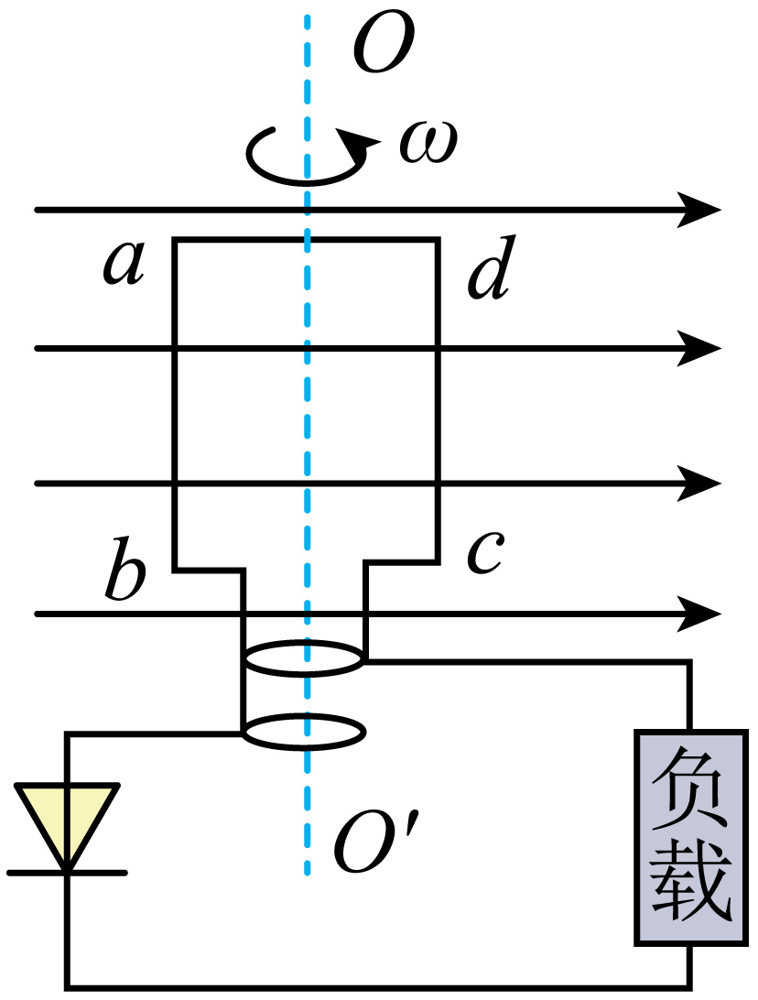

# Physics - 题目 2924

**ID**: e0a9049ec4d44810bdb7211a698acca9
**年级**: Grade 12
**难度**: Medium
**题型**: Multiple-choice

## 题目
如图所示，矩形线圈的匝数： $n=100$ ，面积 $S=0.01{\rm{m}}{^{2}}$ ，内阻不计，绕垂直磁感线的对称轴 $OO^{′}$ 以角速度 $ω=10{\rm{π}}{\rm{r}}{\rm{a}}{\rm{d}}/{\rm{s}}$ 匀速转动，匀强磁场的磁感应强度大小 $B=1{\rm{T}}$ ，取 ${\rm{π}}{^{2}}=10$ ，与负载相连的是理想二极管（正向电阻为零，反向电阻无穷大）。​​​​​​​‌若负载为 $R=10Ω$ 的电阻，则负载的热功率为（      ）

## 解答

1. 线圈中产生的是正弦交流电，电动势的峰值
2. $E{{}_{{\rm{m}}}}=nBSω=10{\rm{π}}{\rm{V}}$
3. 如果没有二极管，电流的有效值为 $\frac {E{{}_{{\rm{m}}}}}{\sqrt {2}R}$ ，由于二极管的单向导电性，电流有效值为原来的 $\frac {1}{\sqrt {2}}$ ，即
4. $I=\frac {E{{}_{{\rm{m}}}}}{2R}$
5. 因此负载的热功率
6. $P=I{^{2}}R=25{\rm{W}}$
7. 故选A。

## 知识点

**中文**:
  - 正弦式交变电流的相关计算

**English**:
  - Calculations of Sinusoidal AC

---
