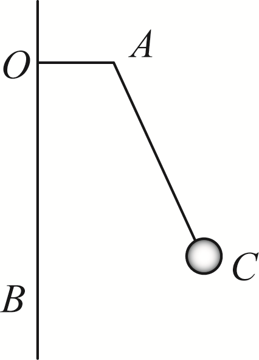

# Physics - 题目 2974

**ID**: e32281e50a5d4ae3afad1edce4c0585f
**年级**: Grade 12
**难度**: Medium
**题型**: 非选择题:本题共5小题,共56分。

## 题目
(6分)某科技小组想验证匀速圆周运动向心力大小的表达式F_{n}=mω^{2}r,装置如图,用能够显示并调节转动频率的小电动机带动竖直轴匀速转动,OB为竖直轴的中心线,长为d的水平横臂OA固定在OB上,不可伸长的轻细线上端固定在A处,下端穿过球心并固定。​​​​​​​‌在装置后面放一贴有白纸的竖直平板,调节装置使初位置OA、OB所在的平面与竖直平板平行,用平行光源将装置垂直投影在竖直板的白纸上。①描下装置在白纸上的投影O'B'和O'A',测出O'A'的投影长度也为d,说明平行光源与墙垂直。②启动电动机,记录电动机的转动频率f,当小球转动稳定时,利用直尺与影子相切,描下小球轨迹在白纸上影子的最下边缘水平切线C'B',记下小球到达最右边缘影子的竖直切线C'C'_{1},C'B'与C'C'_{1}交于C'点,B'为C'B'与O'B'的交点。③关闭电动机,改变电动机的转动频率,重复上述实验。(1)已知当地的重力加速度为g,测出了小球的直径D,为验证向心力公式,还需测量选项中描述的物理量即可。(从下列四个选项中选择一个)

## 解答

1. 基础考点：验证匀速圆周运动向心力大小的表达式
2. (1)设细线与竖直方向的夹角为θ,根据牛顿第二定律得mgtanθ=mω^{2}r,故需要验证此式成立。其中m可消去,A错误。测出O'、B'的高度差h后,由于不知道θ,无法求出r,因此无法验证向心力公式,B错误。测出AC绳长L后,由于不知道θ,无法求出r,因此无法验证向心力公式,C错误。测出C'A'延长线与B'O'延长线的交点E和B'之间的距离H后,可以求出球心投影与E高度差为 ${\rm (H-\frac{D}{2})}$ ,则r= ${\rm (H-\frac{D}{2})}$ tanθ,ω=2πf,代入mgtanθ=mω^{2}r中得,g=4π^{2}f^{2}${\rm (H-\frac{D}{2})}$ ,故可以验证向心力公式,D正确。
3. (2)根据g=4π^{2}f^{2}${\rm (H-\frac{D}{2})}$ 得H= ${\rm \frac{g}{4{\pi }^{2}}}$ · ${\rm \frac{1}{{f}^{2}}}$ + ${\rm \frac{D}{2}}$ ,则H随 ${\rm \frac{1}{{f}^{2}}}$ 变化的图像为一直线,但不过原点。如果图像纵轴截距为 ${\rm \frac{D}{2}}$ ,斜率为 ${\rm \frac{g}{4{\pi }^{2}}}$ ,则可验证向心力公式F_{n}=mω^{2}r成立。

## 知识点

**中文**:
  - 实验：探究向心力的大小

**English**:
  - Experiment: Investigating Magnitude of Centripetal Force

---
