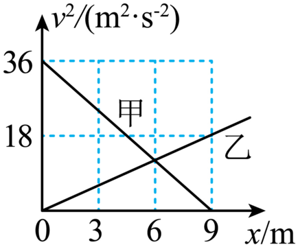

# Physics - 题目 2297

**ID**: e405038067c34dc9adf928614643b58d
**年级**: Grade 12
**难度**: Medium
**题型**: Multiple-choice

## 题目
甲、乙两辆汽车同时同地出发，沿同方向做直线运动，两车速度的平方 $v{{}^{2}}$ 随x的变化图像如图所示，下列说法正确的是（      ）​​​​​​​‌

## 解答

1. B．根据 $v{{}^{2}}-v{{}_{0}^{2}}=2ax$ 并根据题给图像可推知甲、乙两车的初速度大小分别为
2. $v{{}_{0甲}}=6{\rm{m}}{\rm{/}}{\rm{s}}$
3. $v{{}_{0乙}}=0$
4. $v{{}^{2}}-x$ 图像的斜率的绝对值表示汽车加速度大小的2倍，所以甲、乙两车的加速度大小分别为
5. $a{{}_{甲}}=2{\rm{m}}{\rm{/}}{\rm{s}}{{}^{{\rm{2}}}}$
6. $a{{}_{乙}}=1{\rm{m}}{\rm{/}}{\rm{s}}{{}^{{\rm{2}}}}$
7. 且甲做匀减速直线运动，乙做匀加速直线运动，故B错误；
8. A．汽车甲停止前，甲、乙两车相距最远时二者速度相同，设共经历时间为t_{1}，则
9. $a{{}_{乙}}t{{}_{1}}=v{{}_{0甲}}-a{{}_{甲}}t{{}_{1}}$
10. 解得
11. $t{{}_{1}}=2{\rm{s}}$
12. 此时甲车的位移为
13. $x{{}_{甲}}=v{{}_{0甲}}t{{}_{1}}-\frac {1}{2}a{{}_{甲}}t{{}_{1}^{2}}=8{\rm{m}}$
14. 故A正确；
15. C．甲车总运动时间为
16. $t{{}_{2}}=\frac {v{{}_{0甲}}}{a{{}_{甲}}}=3{\rm{s}}$
17. 甲停下时位移为9m，而此时乙车的位移为
18. $x{{}_{乙}}=\frac {1}{2}a{{}_{乙}}t{{}_{2}^{2}}=\frac {9}{2}{\rm{m}}<{\rm{9}}{\rm{m}}$
19. 所以甲、乙两车相遇一定发生在甲车停下之后，设相遇时刻为t，则有
20. $\frac {1}{2}a{{}_{乙}}t{{}^{2}}=9{\rm{m}}$
21. 解得
22. $t=3\sqrt {2}{\rm{s}}$
23. 故C错误；
24. D．汽车甲、乙在x＝6m处的速度大小为
25. $v=\sqrt {2a{{}_{乙}}x}=\sqrt {v{{}_{0甲}^{2}}-2a{{}_{甲}}x}{\rm{=}}2\sqrt {3}{\rm{m}}{\rm{/}}{\rm{s}}$
26. 故D错误。
27. 故选A。

## 知识点

**中文**:
  - 匀变速直线运动的速度—位移公式及其应用

**English**:
  - Velocity-Displacement Formula and Applications

---
