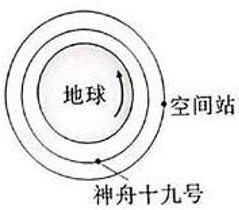

# Physics - 题目 513

**ID**: e857bab1c7ef4bd3bcc67552a1b6d78f
**年级**: Grade 12
**难度**: Medium
**题型**: 单项选择题

## 题目
2024年10月30日，载有3名航天员的神舟十九号载人飞船由长征二号 $F$ 运载火箭成功发射至预定轨道，飞船入轨后，将按照预定程序与空间站组合体进行自主快速交会对接。​​​​​​​‌对接后的“结合体”仍在空间站原轨道运行。若对接前“空间站”与“神舟十九号”在如图所示的轨道上做匀速圆周运动，则（      ）

## 解答

1. “神舟十九号”与“空间站”对接前绕地球做匀速圆周运动，万有引力提供向心力： $\frac {GMm}{r{^{2}}}=mr\frac {4π{^{2}}}{T{^{2}}}=m\frac {v{^{2}}}{r}=ma$ ，解得 $T=2π\sqrt {\frac {r{^{3}}}{GM}},\quad v=\sqrt {\frac {GM}{r}},\quad ω=\frac {2π}{T}$ ，“神舟十九号”的轨道半径小于“空间站”的轨道半径，则“空间站”的线速度小于“神舟十九号”的线速度，“空间站”的角速度小于“神舟十九号”的角速度，A、B错误。“神舟十九号”需要经过点火加速才能从低轨道变轨进入高轨道，实现对接，C正确。对接后“结合体”绕地球运行周期等于对接前“空间站”的运行周期，D错误。

## 知识点

**中文**:
  - 卫星变轨与对接问题

**English**:
  - Satellite Orbit Change and Docking

---
