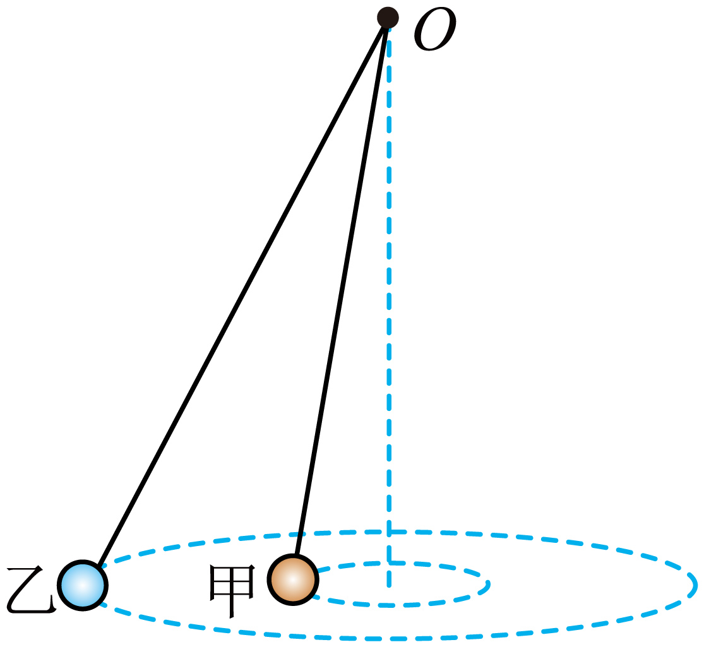

# Physics - 题目 533

**ID**: f45d41cf0dd24be6a65e043c8a886ac2
**年级**: Grade 12
**难度**: Medium
**题型**: Multiple-choice

## 题目
如图所示，小球甲、乙通过轻绳悬挂在O点，两球在同一水平面内做匀速圆周运动，则（      ）​​​​​​​‌

## 解答

1. 设细绳与竖直方向的夹角为 $θ$ ，绳长为L，对小球，有 $mg{\tan}θ=ma$ ，解得 $a=g{\tan}θ$ ，因为乙球与竖直方向的夹角 $θ$ 大，所以乙球的向心加速度比甲球的大，故AB错误；设细绳与竖直方向的夹角为 $θ$ ，绳长为L，对小球有 $mg{\tan}θ=mω{^{2}}L\sin θ$ ，解得 $ω=\sqrt {\frac {g}{L{\cos}θ}}$ ，由题图几何关系可知， $L{\cos}θ$ 为小球悬点到其做圆周运动所在水平面的高度，由题意可知，两小球的该高度相等，所以两小球的角速度相同，故C正确，D错误。

## 知识点

**中文**:
  - 圆锥摆问题

**English**:
  - Conical Pendulum Problems

---
