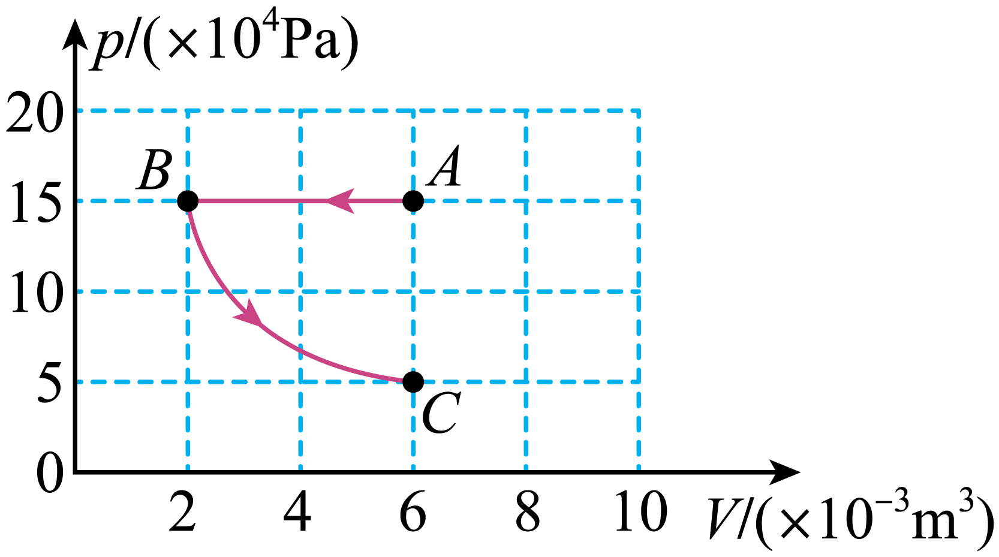

# Physics - 题目 427

**ID**: f705b30203d64f408c0fdc9bec9020db
**年级**: Grade 12
**难度**: Medium
**题型**: Multiple-choice

## 题目
如图所示，一定质量的理想气体经历了A→B→C的状态变化，下列说法正确的是（      ）​​​​​​​‌

## 解答

1. A．由图像可知，A→B过程中，气体体积减小，外界对气体做正功为
2. $W=pΔV=15\times 10{^{4}}\times 4\times 10{^{-3}}{\rm{J}}={{6}}{{0}}{{0}}{\rm{J}}$
3. 故A错误；
4. C．A→B过程中，气体压强不变，体积减小，根据理想气体状态方程 $\frac {pV}{T}=C$ 可知，气体温度降低，内能减小；根据热力学第一定律可知，气体放出热量大于外界对气体做功，故C错误；
5. D．根据图像可知
6. $p{{}_{B}}V{{}_{B}}=p{{}_{C}}V{{}_{C}}$
7. 根据理想气体状态方程可知， $T{{}_{B}}=T{{}_{C}}$ ，则B→C过程气体内能不变，气体体积增大，气体对外界做功，根据热力学第一定律可知，气体吸收热量与气体对外界做功相等，故D正确；
8. B．根据图像可知 $V{{}_{A}}=V{{}_{C}}$ ， $p{{}_{A}}>p{{}_{C}}$ ，可得 $T{{}_{A}}>T{{}_{C}}$ ，则A→B→C过程中，气体内能减小，根据 $p-V$ 图像与横轴围成的面积表示做功，可知整个过程，外界对气体做正功，根据热力学第一定律可知，气体向外放热，故B错误。
9. 故选D。

## 知识点

**中文**:
  - 热力学第一定律与理想气体状态方程的综合应用

**English**:
  - Integrated Application of 1st Law and Ideal Gas Law

---
