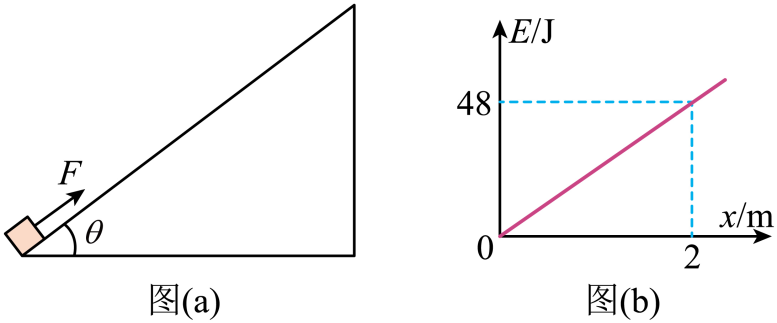

# Physics - 题目 55

**ID**: 14eabaad32684fffa2253c11193c3926
**年级**: Grade 12
**难度**: Medium
**题型**: Multiple-select

## 题目
如图（a）所示，足够长的固定斜面倾角为 $θ=37{}^\circ $ ，斜面底端有一质量为2kg的物块（可视为质点）。​​​​​​​‌现用一沿斜面向上的恒力 $F=32{\rm{N}}$ 使物块由静止开始沿斜面向上运动，取斜面底端为零势能点，运动过程中物块的机械能E与物块的位移x的关系如图（b）所示，重力加速度g取 $10{\rm{m}}/{\rm{s}}{^{2}},{\sin}37{}^\circ =0.64,{\cos}37{}^\circ =0.8$ ，则下列说法正确的是（      ）

## 解答

1. B．由能量守恒可知，拉力 $F$ 和摩擦力对物块做的功等于物块机械能的增加量，所以图（b）中图线的斜率 $k=\frac {48{\rm{J}}}{2{\rm{m}}}=24{\rm{N}}=F-{\rm μm}g{\cos}37{}^\circ $ ，解得 $μ=0.5$ ，B错误；
2. A．由牛顿第二定律可知，物块沿斜面上滑的加速度大小 $a=\frac {F-f-mg{\sin}37{}^\circ }{m}=6{\rm{m}}/{\rm{s}}{^{2}}$ ，A正确；
3. C．由运动学公式可知，物块向上滑动 $2{\rm{m}}$ 时，速度的大小 $v=\sqrt {2ax}=2\sqrt {6}{\rm{m}}/{\rm{s}}$ ，C正确；
4. D．物块沿斜面向上滑动 $2{\rm{m}}$ 的过程中，物块与斜面间摩擦产生的热量 $Q={\rm μm}gx{\cos}37{}^\circ =16{\rm{J}}$ ，D错误。选AC。

## 知识点

**中文**:
  - 功能原理、能量守恒与曲线运动的综合

**English**:
  - Energy Conservation in Curvilinear Motion

---
