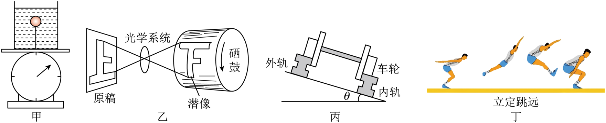

# Physics - 题目 1728

**ID**: 1df99d0f43d84c51be93666c887e8023
**年级**: Grade 12
**难度**: Medium
**题型**: Multiple-select

## 题目
物理知识源于生产生活，又服务于生产生活。​​​​​​​‌在具体情境中加强对物理本质的理解，逐渐形成对物理全局性、整体性的认识，才能更好地掌握知识，并在具体问题的应用中使生活更加美好。下列几幅图中有关物理情景的描述中正确的有（      ）

## 解答

1. 图甲中悬线断裂小球上升时，相同体积的水球下降，由于水的密度大，失重较多超重较少，因此台秤的示数会减小，A错误；静电复印机中的半导体硒是特殊的光电材料，复印材料时原稿上的字迹通过光学系统投影在硒鼓表面形成带正电的静电潜像，它将带负电的墨粉吸附在潜像上，此后带正电的白纸与硒鼓接触将墨粉吸附在纸上，墨粉在高温环境下熔化并深入纸张，从而形成持久的字迹，B正确；火车转弯时需要向心力，为减小轮缘的侧向压力，内、外轨设计成一定的高度差，当火车按规定的速度行驶时重力和支持力的合力提供向心力，火车与铁轨之间不会出现侧向压力，C正确；运动员训练立定跳远落地时通常会弯曲膝盖，目的是延长与地面的作用时间，从而减小平均作用力，D正确。

## 知识点

**中文**:
  - 尖端放电、静电屏蔽与静电吸附
  - 火车转弯问题

**English**:
  - Point Discharge, Electrostatic Shielding, and Adsorption
  - Train Turning Problems

---
