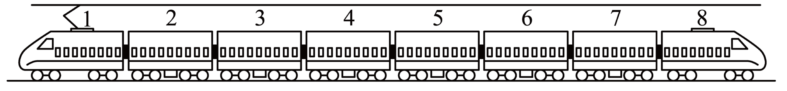

# Physics - 题目 1289

**ID**: 251f8133345344959bd7647ecaa9fe59
**年级**: Grade 12
**难度**: Medium
**题型**: Multiple-select

## 题目
G88次列车从成都东站至北京西站全程仅需7小时31分钟。​​​​​​​‌某动车组由8节车厢组成，其中第2、3、6、7节车厢为动力车厢，其余车厢无动力。每节动力车厢所提供的驱动力大小均为 $F$ ，每节车厢所受的阻力大小相同，各车厢的质量相同。该列车动力全开沿水平直轨道行驶时，下列说法正确的是（      ）

## 解答

1. 若列车匀速行驶，因每节车厢都受阻力作用，所以车厢间的作用力不一定都为零，例如第7、8节车厢间的作用力不为零，第4、5节车厢间的作用力为零，选项A错误、B正确；设每节车厢的质量为 $m$ ，所受阻力为 $f$ ，若列车匀加速行驶，整体的加速度 $a=\frac {4F-8f}{8m}$ ，则对前3节车厢的整体分析可知 $2F-3f-F{{}_{34}}=3ma$ ，解得 $F{{}_{34}}=\frac {F}{2}$ ，选项C错误；同理若第6节车厢失去动力，整体的加速度 $a^{′}=\frac {3F-8f}{8m}$ ，前6节车厢的加速度 $a^{′}=\frac {2F-6f+F{{}_{67}}}{6m}$ ，解得 $F{{}_{67}}=\frac {F}{4}$ ，选项D正确。

## 知识点

**中文**:
  - 连接体问题（整体和隔离法）、临界问题

**English**:
  - Connected Bodies Problems (Whole/Isolation Method), Critical Problems

---
