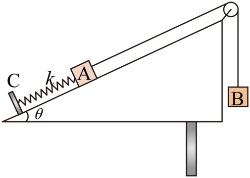

# Physics - 题目 1655

**ID**: 28067f9fdeec4df199a77beacb6ff30f
**年级**: Grade 12
**难度**: Medium
**题型**: Multiple-select

## 题目
如图，轻质弹簧一端与垂直固定在斜面上的板C相连，另一端与物体A相连。​​​​​​​‌物体A置于光滑固定斜面上，斜面的倾角 $θ=30{}^\circ $ 。A上端连接一轻质细线，细线绕过光滑的定滑轮与物体B相连且始终与斜面平行。开始时托住B，A静止且细线恰好伸直，然后由静止释放B。已知物体A、B的质量均为m，弹簧的劲度系数为k，当地重力加速度为g，B始终未与地面接触。从释放B到B第一次下落至最低点的过程中，下列说法正确的是（      ）。

## 解答

1. A．刚释放物体B时，以A、B组成的系统为研究对象，有
2. $mg=(m+m)a$
3. 解得
4. $a=\frac {1}{2}g$
5. 对B研究
6. $mg-T=ma$
7. 解得
8. $T=\frac {1}{2}mg$
9. 故物体A受到细线的拉力大小为 $\frac {mg}{2}$ ，故A正确；
10. BC．对于A、B物体以及弹簧组成的系统，只有弹簧的弹力和重力做功，系统机械能守恒，B减小的机械能转化为A的机械能以及弹簧的弹性势能，故当B下落至最低点时，A和弹簧组成系统的机械能最大，且此时A上升到最高位置，根据对称性可知产生B的加速度大小也为
11. $a^{′}=a=\frac {1}{2}g$
12. 故对B受力分析，根据牛顿第二定律可知
13. $T^{′}-mg=ma^{′}$
14. 解得
15. $T^{′}=\frac {3}{2}mg$
16. 故AB整体研究，可得
17. $kx^{′}+mg{\sin}30{}^\circ -T^{′}=(m+m)a^{′}$
18. 解得
19. $kx^{′}=2mg$
20. 对A研究，A受到弹簧拉力、重力和绳子的拉力，则
21. $F{{}_{合}}=kx^{′}+mg{\sin}θ-T^{′}=0$
22. 故B错误，C正确；
23. D．以A、B为研究对象，由牛顿第二定律可知
24. $mg-kx=(m+m)a$
25. 由于弹簧的伸长量x逐渐变大，故加速度逐渐减小，当加速度为0时，速度达到最大，即
26. $x=\frac {mg}{k}$
27. 则
28. $\Delta E{{}_{{\rm{p}}}}=\frac {1}{2}kx{{}^{2}}=\frac {m{{}^{2}}g{{}^{2}}}{2k}$
29. 根据机械能守恒定律可知
30. $mgx=\frac {1}{2}\cdot 2mv{{}^{2}}+\Delta E{{}_{{\rm{p}}}}$
31. 解得
32. $v=\sqrt {\frac {mg{{}^{2}}}{2k}}$
33. 故D正确。
34. 故选ACD。

## 知识点

**中文**:
  - 弹簧问题中机械能守恒定律的应用

**English**:
  - Spring Problems

---
