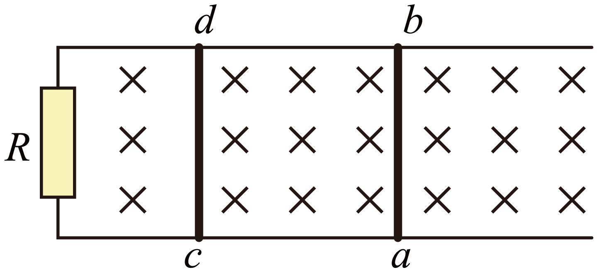

# Physics - 题目 773

**ID**: 2bc41292eea84f09a7784c751374e81c
**年级**: Grade 12
**难度**: Medium
**题型**: Multiple-select

## 题目
如图，两光滑水平固定导轨的左端接有定值电阻R，空间存在竖直向下、磁感应强度为B的匀强磁场，两根质量均为m的棒垂直置于导轨上，间距为L，其中导轨和导体棒ab的阻值可忽略不计，cd棒为绝缘棒。​​​​​​​‌某时刻两棒开始相向运动，运动一段时间后两棒发生弹性碰撞。已知ab棒的初速度大小为 $2v{{}_{0}}$ ，cd棒的初速度大小为 $\frac {v{{}_{0}}}{2}$ ，碰撞后cd棒以速率 $v{{}_{0}}$ 弹回，碰撞时间极短，导轨足够长，导轨间距为L，两棒始终与导轨垂直，则（      ）

## 解答

1. A．根据弹性碰撞过程动量守恒和机械能守恒可知碰撞后两棒速度交换，碰撞前瞬间ab棒速率为 $v{{}_{0}}$ ，A正确。
2. C．cd棒为绝缘棒，碰撞前速度不变，碰撞前瞬间cd棒速率为 $\frac {v{{}_{0}}}{2}$ ，则碰撞后ab棒的速率为 $\frac {v{{}_{0}}}{2}$ ，设从碰撞后瞬间到ab棒停止，通过ab棒某横截面的电荷量为 $q{{}_{1}}$ ，ab受到的平均安培力为 ${\overline{F}}{{}_{安}}=B{\overline{I}}L$ ，电荷量为 $q={\overline{I}}t$ ，电流 ${\overline{I}}=\frac {BL{\overline{v}}}{R}$ ，由动量定理有 $-{\overline{F}}{{}_{安}}t=0-m\frac {v{{}_{0}}}{2}$ ，解得碰后ab棒运动的最大路程为 $x{{}_{1}}={\overline{v}}t=\frac {mv{{}_{0}}R}{2B{^{2}}L{^{2}}}$ ，C正确；
3. BD．从ab棒开始运动到碰撞前瞬间，根据动量定理有 $q{{}_{2}}BL=m\left ({2v{{}_{0}}}\right )-mv{{}_{0}}$ ，可得 $q{{}_{2}}=\frac {mv{{}_{0}}}{BL}$ ，根据以上分析解得ab棒碰前的运动路程为 $x{{}_{2}}=\frac {mv{{}_{0}}R}{B{^{2}}L{^{2}}}$ ，所以cd棒从开始运动到返回出发位置所用的时间为 $t=\frac {L-x{{}_{2}}}{\frac {v{{}_{0}}}{2}}+\frac {L-x{{}_{2}}}{v{{}_{0}}}=\frac {3L}{v{{}_{0}}}-\frac {3mR}{B{^{2}}L{^{2}}}$ ，BD错误。选AC。

## 知识点

**中文**:
  - 导体切割磁感线产生感应电动势（电流）的分析与计算
  - 求解弹性碰撞问题

**English**:
  - Analysis and Calculation of Cutting Magnetic Field Lines
  - Solving Elastic Collision Problems

---
