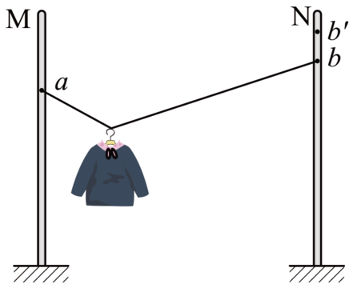

# Physics - 题目 175

**ID**: 3846887488b44d0fa23159d0f36b7783
**年级**: Grade 12
**难度**: Medium
**题型**: 多项选择题

## 题目
如图所示，轻质不可伸长的晾衣绳两端分别固定在竖直杆M、N上的a、b两点，悬挂衣服的衣架钩是光滑的，挂于绳上处于静止状态。​​​​​​​‌如果只人为改变一个条件，当衣架静止时，下列说法正确的是（      ）

## 解答

1. 如图所示，两个绳子是对称的，与竖直方向夹角是相等的。
2. 
3. 假设绳子的长度为x，则有 $x\cos \theta =L$ ，绳子一端在上下移动的时候，绳子的长度不变，两杆之间的距离不变，则θ角度不变。
4. AC．两个绳子的合力向上，大小等于衣服的重力，由于夹角不变，所以绳子的拉力不变，A正确，C错误；
5. B．当N向右移动后，根据 $x\cos \theta =L$ ，即L变大，绳长不变，所以θ角减小，绳子与竖直方向的夹角变大，绳子的拉力变大，B正确；
6. D．绳长和两杆距离不变的情况下，θ不变，所以挂的衣服质量变化，不会影响悬挂点的移动，D错误。选AB。

## 知识点

**中文**:
  - 解析法在解动态平衡问题中的应用

**English**:
  - Analytical Method for Dynamic Equilibrium

---
