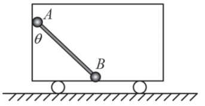

# Physics - 题目 890

**ID**: 39d71fe66bc3467aa42890bef005c550
**年级**: Grade 12
**难度**: Medium
**题型**: Multiple-select

## 题目
如图，水平地面上有一小车，车内有质量分别m、2m的A、B两小球，用轻杆相连，杆与竖直方向的夹角为 $θ=30\degree $ 。​​​​​​​‌A球靠在光滑的竖直侧壁上，B球在粗糙的水平底面上，且受到的最大静摩擦力与正压力之比为 $k$ 。小车可以以不同的加速度向右运动，现要保证轻杆与车厢相对静止，重力加速度用 $g$ 表示，下列说法正确的是（      ）

## 解答

1. 根据题意，设杆对球A的作用力大小为F，对A球，竖直方向上由平衡条件有 $F{\cos}θ=mg$ ，解得 $F=\frac {mg}{{\cos}θ}$ ，轻杆与车厢相对静止， $θ$ 角不交则轻杆对小球A的作用力始终为恒力， ${\rm{A}}$ 正确；杆对球B的作用力大小始终也为 $F=\frac {mg}{{\cos}θ}$ ，当小球B对底面的摩擦力等于0时，对B，根据牛顿第二定律 $F\sin θ=2ma{{}_{1}}$ ，解得 $a{{}_{1}}=\frac {\sqrt {3}g}{6}{\rm ，B}$ 错误；若 $k=\frac {4\sqrt {3}}{9},$ 对AB整体分析得，B与底面间的最大静摩擦力为 $f{{}_{1}}=3kmg$ ，当A与侧壁无弹力时，且B与底面间有最大静摩擦力时，对AB整体，根据牛顿第二定律 $f{{}_{1}}=3ma{{}_{2}}$ ，解得 $a{{}_{2}}=\frac {4\sqrt {3}}{9}g$ ，但当A与侧壁恰无弹力时，A有最大加速度，由杆的水平分力维持，此时对A，根据牛顿第二定律 $F\sin θ=ma{{}_{3}}$ ，解得 $a{{}_{3}}=\frac {\sqrt {3}}{3}g$ ， $a{{}_{3}}<a{{}_{2}}$ ，因此允许的最大加速度为 $\frac {\sqrt {3}g}{3}{\rm ，C}$ 正确；若 $k=\frac {\sqrt {3}}{12},$ 当小车做匀加速直线运动时，对A、B整体受力分析得， $f+N=3ma{{}_{4}}{\rm ，\mathit{N}}$ 为侧壁对小球A的作用力，隔离A分析得 $N-F\sin θ=ma{{}_{4}}$ ，联上解得 $N=\frac {f+\sqrt {3}mg}{2}$ ， $f{{}_{ma{{}_{4}}}}=3kmg$ ，解得 $N=\frac {5\sqrt {3}}{8}mg{\rm ，D}$ 错误。

## 知识点

**中文**:
  - 连接体问题（整体和隔离法）、临界问题

**English**:
  - Connected Bodies Problems (Whole/Isolation Method), Critical Problems

---
