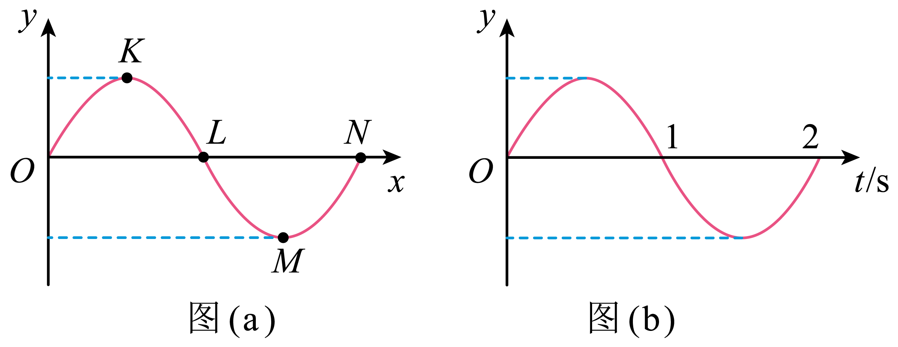

# Physics - 题目 990

**ID**: 44d93148f70a47d08397e52e27049840
**年级**: Grade 12
**难度**: Medium
**题型**: Multiple-select

## 题目
一列简谐横波在 $t=0$ 时刻的波形如图（a）所示，图（b）表示介质中某质点的振动图像。​​​​​​​‌下列说法正确的是（      ）

## 解答

1. 图（b）可知该波的周期为2s，A正确； $t=1{\rm{s}}$ 时恰好经过半个周期，则 $t=1{\rm{s}}$ 时 $ON$ 间的波形与图（a）相反，B错误；图（b）可知0时刻质点从平衡位置向y轴正方向振动，若波沿 $x$ 轴正方向传播，同侧法可知图（a）L点恰好从平衡位置向y轴正方向振动，则图（b）可能为 $L$ 点的振动图像，C正确；同侧法可知图（a）N点恰好从平衡位置向y轴负方向振动，结合C选项分析可知，图（b）不可能为N点的振动图像，D错误。

## 知识点

**中文**:
  - 波的图像和振动图像的综合应用

**English**:
  - Integrated Application of Wave and Vibration Graphs

---
