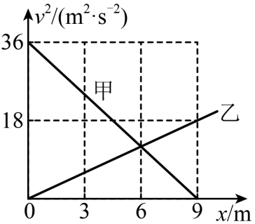

# Physics - 题目 1537

**ID**: 44e42acb7efa4b888be99f7384617341
**年级**: Grade 12
**难度**: Medium
**题型**: Multiple-select

## 题目
甲、乙两辆汽车同时同地出发，沿同一方向做直线运动，两车速度的平方v^{2}随位移x的变化图像如图所示，下列说法正确的是（      ）​​​​​​​‌

## 解答

1. 由匀变速直线运动的速度 $\mathbf{-}$ 位移公式： $v{^{2}}-v{{}_{0}^{2}}=2ax$ 可知： $v{^{2}}=2ax+v{{}_{0}^{2}}$ ；
2. A．由图 $v{^{2}}-x$ 图像可知，图线甲的斜率 $k{{}_{甲}}=2a{{}_{甲}}=\frac {0-36}{9}{\rm{m}}{\rm{/}}{\rm{s}}{^{{{2}}}}=-4{\rm{m}}{\rm{/}}{\rm{s}}{^{{{2}}}}$ ，负号表示方向，汽车甲的加速度 $a{{}_{甲}}=-2{\rm{m}}{\rm{/}}{\rm{s}}{^{{{2}}}}{\rm ，A}$ 错误；
3. B．由图 $v{^{2}}-x$ 图像可知，乙图线的斜率 $k{{}_{乙}}=2a{{}_{乙}}=\frac {18}{9}{\rm{m}}{\rm{/}}{\rm{s}}{^{{{2}}}}=2{\rm{m}}{\rm{/}}{\rm{s}}{^{{{2}}}}$ ，汽车乙的加速度 $a{{}_{乙}}=1{\rm{m}}{\rm{/}}{\rm{s}}{^{{{2}}}}$ ，由图像 $v{{}_{甲0}}{^{2}}=36$ ，解得汽车甲的初速度 $v{{}_{甲0}}=6{\rm{m}}{\rm{/}}{\rm{s}}$ ，汽车乙的初速度为0，当两车速度相等时两车相距最远，设经时间t两车相距最远，则 $v{{}_{甲0}}+a{{}_{甲}}t=a{{}_{乙}}t$ ，代入数据解得 $t=2{\rm{s}}{\rm ，B}$ 正确；
4. C．由图示图像可知， $x=6{\rm{\;}}{\rm{m}}$ 时两车速度大小相等，乙车做初速度为零的匀加速直线运动，位移 $x=6{\rm{m}}$ 时乙车的速度 $v{{}_{乙}}=\sqrt {2a{{}_{乙}}x}=\sqrt {2\times 1\times 6}{\rm{m}}{\rm{/}}{\rm{s}}=2\sqrt {3}{\rm{m}}{\rm{/}}{\rm{s}}{\rm ，C}$ 正确；
5. D．两车同时同地出发，经过相等时间位移相同时相遇，设经过时间 $t{{}_{1}}$ 两车相遇，此时两车位移相等 $x=v{{}_{甲0}}t{{}_{1}}+\frac {1}{2}a{{}_{甲}}t{{}_{1}^{2}}=\frac {1}{2}a{{}_{乙}}t{{}_{1}^{2}}$ ，代入数据解得 $x=8{\rm{m}}$ ， $t{{}_{1}}=4{\rm{s}}$ ， $t=3{\rm{s}}$ 时，甲已经减速至停止，所以甲已经停止，1s后乙追上甲，所以真正位移为 $x=\frac {1}{2}a{{}_{甲}}t{^{2}}=9{\rm{m}}{\rm ，D}$ 错误。选BC。

## 知识点

**中文**:
  - 追及与相遇问题

**English**:
  - Chase and Encounter Problems

---
