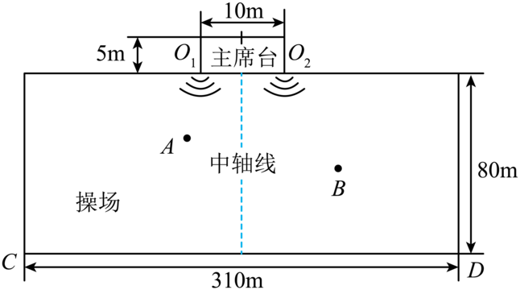

# Physics - 题目 1593

**ID**: 45ccf23dd2bb4f30b4af35a1391f4175
**年级**: Grade 12
**难度**: Medium
**题型**: Multiple-select

## 题目
某学校的长方形操场尺寸如图所示，主席台靠近操场的两个角有两个喇叭 $O{{}_{1}}$ 、 $O{{}_{2}}$ ，播放着完全相同的音乐，音乐频率为170Hz。​​​​​​​‌一位同学发现 $A$ 、 $B$ 位置的音量听起来比周围更大。已知人耳朵（看作质点）和两个喇叭刚好在同一水平面，空气中声音的传播速度为340m/ ${\rm s，}\sqrt {5}\approx 2.24$ 。下列说法正确的是（      ）

## 解答

1. 声波是一种纵波，故A错误；两列相同的波在同一空间叠加，形成某些地方振动加强，某些地方振动减弱的稳定现象，为波的干涉现象，声波虽然为纵波也有这种性质，故B正确； $A$ 、 $B$ 处虽然都是振幅极大位置，但 $O{{}_{1}}A$ 与 $O{{}_{1}}B$ 的距离差不一定恰好为波长的整数倍，因此当 $A$ 处介质的振动达到极大位置时， $B$ 处介质的振动不一定也达到极大位置，故C错误；几何关系可知 $\left |{O{{}_{1}}C}\right |-\left |{O{{}_{2}}C}\right |=\sqrt {150{^{2}}+80{^{2}}}-\sqrt {160{^{2}}+80{^{2}}}=170-80\sqrt {5}\approx -9.2{\rm{m}}$ ，同理 $\left |{O{{}_{1}}D}\right |-\left |{O{{}_{2}}D}\right |\approx 9.2{\rm{m}}$ ，声波波长 $λ=\frac {v}{f}=2{\rm{m}}$ ，因此从 $C$ 点走到 $D$ 点的过程中共会经历 $Δx=-8{\rm{m}}{\rm ，-6m，-4m，-2m，0m，2m，4m，6m，8m}$ 共9个音量极大位置，故D正确。

## 知识点

**中文**:
  - 波的加强点与减弱点相关问题

**English**:
  - Constructive and Destructive Interference Points

---
