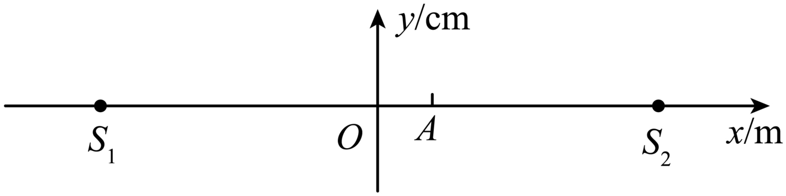

# Physics - 题目 1424

**ID**: 4fed07a6521f4eb682584928fc77fc4b
**年级**: Grade 12
**难度**: Medium
**题型**: Multiple-select

## 题目
如图所示，x轴上有两个波源S_{1}、S_{2}，位置坐标分别为-6m、6m，两个波源形成的简谐横波已沿x轴稳定传播，波速均为1m/s，形成了稳定的干涉。​​​​​​​‌从某时刻开始，波源S_{1}的振动方程为 $y{{}_{1}}=10{\sin}\left ({\frac {π}{2}t+\frac {π}{4}}\right ){\rm{c}}{\rm{m}}$ ，波源S_{2}的振动方程为 $y{{}_{2}}=10{\sin}\left ({\frac {π}{2}t-\frac {π}{4}}\right ){\rm{c}}{\rm{m}}$ ，x轴上A点的位置坐标为0.5m，则下列说法正确的是（      ）

## 解答

1. A．根据振动方程可得周期为 $T=4{\rm{s}}$ ，波长为 $λ=vT=4{\rm{m}}$ ，A错误；
2. B．零时刻，波源S_{1}、S_{2}相位不同，不便于判断振动加强或者减弱的情况，假设在S_{1}左侧，坐标为-6.5m处有一同向波源S_{3}，S_{2}右侧坐标为7.5m处有一同向波源S_{4}，如图所示
3. 
4. 此刻两波源均处于波峰位置，则两波源平衡位置的中点A点必然为振动的加强点，因此2s内A振动半个周期的路程为40cm，B正确；
5. C．波源连线上，相邻加强点相差半个波长，因此，连线上加强点的坐标，从左向右依次为-5.5m、-3.5m、-1.5m、0.5m、2.5m、4.5m，共6个，C正确；
6. D．相邻加强点和减弱点相差四分之一个波长，因此，连线上减弱点的坐标，从左向右依次为-4.5m、-2.5m、-0.5m、1.5m、3.5m、6.5m，共6个，D错误。选BC。

## 知识点

**中文**:
  - 波的加强点与减弱点相关问题

**English**:
  - Constructive and Destructive Interference Points

---
