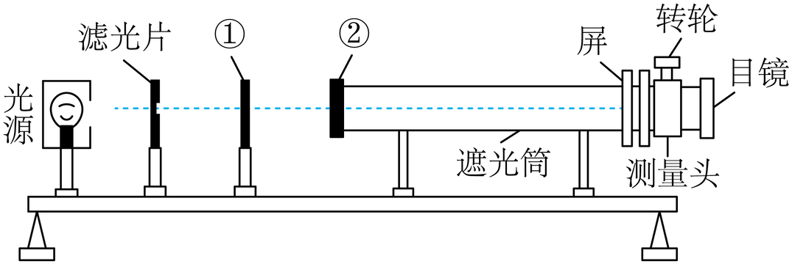

# Physics - 题目 1000

**ID**: 54944fb3aacf4c1cbd50518a3e44d35a
**年级**: Grade 12
**难度**: Medium
**题型**: Multiple-select

## 题目
用如图所示的装置进行双缝干涉实验，分别使用红光和绿光作为光源，下列说法正确的是（      ）​​​​​​​‌

## 解答

1. ①是单缝，②是双缝，A错误；由 $Δx=\frac {L}{d}λ$ 可知，条纹间距与①和②的距离无关，红光的波长大于绿光，红光条纹间距更大，B错误，C正确；     相邻条纹间距应为 $\frac {a}{n-1}{\rm ，D}$ 正确。

## 知识点

**中文**:
  - 干涉条纹和光的波长之间的关系

**English**:
  - Relationship between Interference Fringes and Wavelength

---
