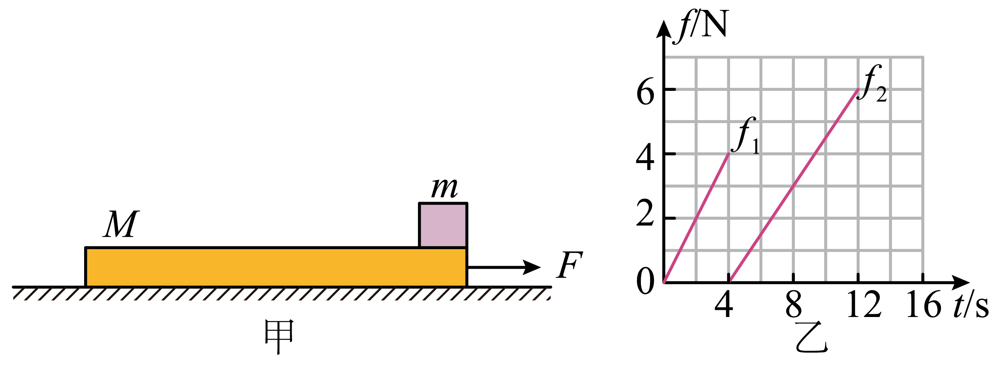

# Physics - 题目 997

**ID**: 565ab5cbdcf04d6eb7b1b35ee72df991
**年级**: Grade 12
**难度**: Medium
**题型**: Multiple-select

## 题目
如图甲所示，粗糙水平面上：静置一质量M=1kg的长木板，其上叠放一质量为m的木块。​​​​​​​‌现给木板施加一随时间t均匀增大的水平力F=kt（k=1N/s）。已知木板与地面间的摩擦力为f_{1}，木块与木板之间的摩擦力为f_{2}，f_{1}和f_{2}随时间t的变化图线如图乙所示。若最大静摩擦力均与相应的滑动摩擦力相等，重力加速度g=10m/s^{2}。下列说法正确的是（      ）

## 解答

1. AB．设木板与地面间的动摩擦因数为μ_{1}，由图乙可知，0 ~ 4s时间内，木板与地面间的摩擦力f_{1}随F增大而增大，木块与木板之间的摩擦力f_{2}为0，说明木板和木块均静止，4s后，摩擦力f_{1}保持不变，说明木板开始相对地面滑动，且滑动摩擦力
2. f_{1}=μ_{1}(M＋m)g=4N
3. 设木板与木块间的动摩擦因数为μ_{2}，4 ~ 12s内，木块与木板之间的摩擦力f_{2}随F增大而增大，说明摩擦力f_{2}为静摩擦力，木板和木块相对静止，一起加速运动，对木块和木板整体，根据牛顿第二定律得
4. F－μ_{1}(M＋m)g=(M＋m)a
5. 对木块根据牛顿第二定律得
6. f_{2}=ma
7. 当t=12s时
8. F=kt=12N
9. 由图像得
10. f_{2}=6N
11. 代入数据解得
12. m=3kg，μ_{1}=0.1
13. AB正确；
14. C．12s后，摩擦力f_{2}保持不变，说明木块相对木板开始滑动，且滑动摩擦力
15. f_{2}=μ_{2}mg=6N
16. 代入数据解得
17. μ_{2}=0.2
18. C错误；
19. D．0 ~ 4s时间内，木块和木板静止，4 ~ 16s时间内，f—t图像与时间轴围成的面积表示摩擦力的冲量大小，木块所受摩擦力的冲量为
20. $I{{}_{2}}=\frac {4+12}{2}\times 6{\rm{N}}\cdot {\rm{s}}=48{\rm{N}}\cdot {\rm{s}}$
21. 木板所受合外力的冲量为
22. $I{{}_{1}}=I{{}_{{\rm{F}}}}-I{{}_{{\rm{f}}}}-I{{}_{2}}=\frac {4+16}{2}\times 12{\rm{N}}\cdot {\rm{s}}-4\times 12{\rm{N}}\cdot {\rm{s}}-48{\rm{N}}\cdot {\rm{s}}=24{\rm{N}}\cdot {\rm{s}}$
23. 由动量定理得
24. I_{2}=mv_{2}_{，}I_{1}=Mv_{1}
25. 代入数据解得
26. v_{2}=16m/s，v_{1}=24m/s
27. 则16s末木块与木板的速度大小之比为
28. v_{2}：v_{1}=2：3
29. D正确。
30. 故选ABD。

## 知识点

**中文**:
  - 板块模型

**English**:
  - Plate Model

---
