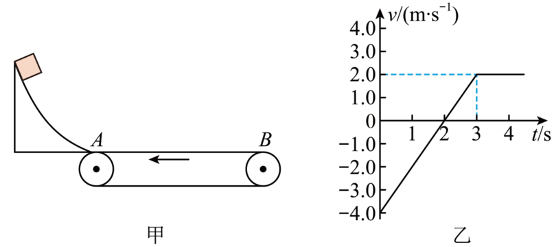

# Physics - 题目 1304

**ID**: 5f78a2555591492c9ab90fb584941530
**年级**: Grade 12
**难度**: Medium
**题型**: Multiple-select

## 题目
如图甲所示，一定长度的水平传送带AB逆时针匀速转动，一物块沿曲面从一定高度处由静止开始下滑，以某一初速度从左端滑上传送带，在传送带上由速度传感器记录下物块速度随时间的变化关系如图乙所示（图中取向左为正方向，以物块刚滑上传送带时为计时起点）。​​​​​​​‌重力加速度取g=10m/s^{2}，则（      ）

## 解答

1. $v-t$ 图像斜率代表加速度，加速度 $a=2{\rm{m}}{\rm{/}}{\rm{s}}{^{{{2}}}}$ ，又 $a=\frac {f}{m}=\frac {{\rm μm}g}{m}=μg$ ，解得 $μ=0.2{\rm ，A}$ 正确； $v-t$ 图像与t轴围成的面积代表位移，物块恰好返回A点，则位移为 ${\rm 0}0=\frac {1}{2}\times (-4)\times 2+\frac {1}{2}\times (3-2)\times 2+2t$ ，得 $t=1.5{\rm{s}}$ ，即4.5s时物块恰好返回A点，B正确；提高传送带的转速，物块在水平传送带运动的初速度、加速度、位移均不变，能返回A点，C错误；降低传送带的转速，物块在水平传送带运动的初速度、加速度、位移均不变，能返回A点，不可能从B端滑落，D错误。

## 知识点

**中文**:
  - 传送带模型

**English**:
  - Conveyor Belt Model

---
