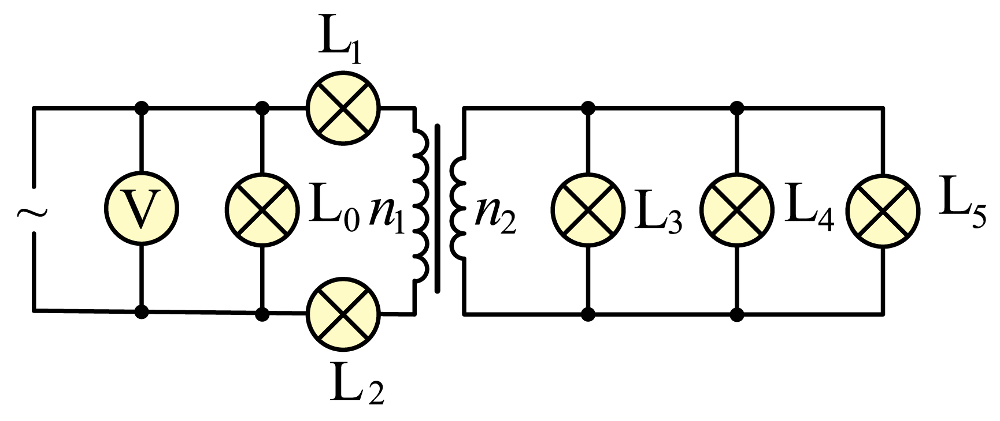

# Physics - 题目 2734

**ID**: 664f88add8c544b2bc8f54fce118caed
**年级**: Grade 12
**难度**: Medium
**题型**: Multiple-select

## 题目
在图示的电路中，交流电源的电动势e随时间t变化的规律为 $e=16\sqrt {2}{\sin}10{\rm{π}}t\left ({{\rm{V}}}\right )$ ，内阻为 $0.5Ω$ ，灯泡 ${\rm{L}}{{}_{1}}$ 、 ${\rm{L}}{{}_{2}}$ 、 ${\rm{L}}{{}_{3}}$ 、 ${\rm{L}}{{}_{4}}$ 、 ${\rm{L}}{{}_{5}}$ 上均标有“3V，3W”的字样。​​​​​​​‌若变压器可视为理想变压器，原线圈的匝数为600匝，6盏灯均正常发光，则（      ）

## 解答

1. A．理想电压表的示数为交表电流的有效值，所以其在 $t=0.2{\rm{s}}$ 时，理想电压表V的示数不为零，A项错误；
2. B．灯泡均正常发光，设灯泡正常发光的电流为I，由电路图可知，原线圈的电流为I，有 $P=UI$ ，解得 $I=1{\rm{A}}$ ，而副线圈上的电流为3I，由于是理想变压器，所以有 $\frac {I}{3I}=\frac {n{{}_{2}}}{n{{}_{1}}}$ ，整理有 $\frac {n{{}_{1}}}{n{{}_{2}}}=\frac {3}{1}$ ，B项正确；
3. C．由之前的分析可知，副线圈的电压为3V，则原线圈的电压为 $U{{}_{原}}$ ，有 $\frac {U{{}_{原}}}{U{{}_{副}}}=\frac {n{{}_{1}}}{n{{}_{2}}}$ ，解得 $U{{}_{原}}=9{\rm{V}}$ ，由于 ${\rm{L}}{{}_{{\rm{1}}}}$ 和 ${\rm{L}}{{}_{2}}$ 与原线圈串联，再与灯泡 ${\rm{L}}{{}_{{\rm{0}}}}$ 并联，所以灯泡 ${\rm{L}}{{}_{{\rm{0}}}}$ 的电压为 $U{{}_{0}}=U{{}_{1}}+U{{}_{2}}+U{{}_{原}}=15{\rm{V}}$ ，电路的电源电动势有效值为 $U{{}_{总}}=\frac {E{{}_{{\rm{m}}}}}{\sqrt {2}}$ ，交流电源内电压有效值为 $U{{}_{内}}=U{{}_{总}}-U{{}_{0}}$ ，电路的总电流为 $I{{}_{总}}=\frac {U{{}_{内}}}{r}$ ，流过灯泡 ${\rm{L}}{{}_{{\rm{0}}}}$ 的电流为 $I{{}_{0}}=I{{}_{总}}-I{{}_{原}}$ ，灯泡 ${\rm{L}}{{}_{{\rm{0}}}}$ 的功率为 $P{{}_{0}}=U{{}_{0}}I{{}_{0}}=15{\rm{W}}$ ，C项正确；
4. D．整个电路的总功率为 $P{{}_{总}}=I{{}_{总}}U{{}_{总}}\mathrm{=}32{\rm{W}}$ ，D项错误。选BC。

## 知识点

**中文**:
  - 理想变压器原、副线圈两端的电压、功率、电流关系及其应用

**English**:
  - Voltage, Power, Current Relations in Ideal Transformers

---
