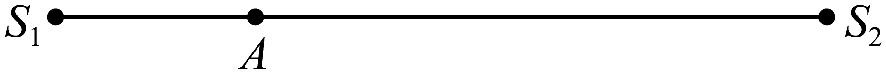

# Physics - 题目 170

**ID**: 6671e2712f8e417d8231522295cd67fb
**年级**: Grade 12
**难度**: Medium
**题型**: Multiple-select

## 题目
如图所示， $S{{}_{1}}$ 和 $S{{}_{2}}$ 是两个振动频率相同，相位差为 $π$ ，振幅均为2cm的横波波源，两者位于同一直线上，相距12m，连线上有一质点 $\mathrm{A}$ ，与 $S{{}_{1}}$ 的距离为3m。​​​​​​​‌ $t=0$ 时两波源同时起振，产生的机械波在介质中传播的速度为2m/s，两列波的波长均为4m，下列说法正确的是（      ）

## 解答

1. 两列波的周期均为 $T=\frac {λ}{v}=\frac {4}{2}{\rm{s}}=2{\rm{s}}$ ，选项A错误；两波源起振方向相反，则振动加强点满足 $\left |{x-(12-x)}\right |=\frac {λ}{2}(2n+1)(n=0,1，2)$ ，可得 $x=5-2n$ ，由于 $0<x<12$ ，解得 $-3.5<n<2.5$ ，即x=1m，3m，5m，7m，9m，11m，即稳定后在 $S{{}_{1}}$ 、 $S{{}_{2}}$ 连线上有6个振动加强点，选项B正确；只有左侧波源S_{1}的振动传到A点经过时间 $t{{}_{1}}=\frac {x{{}_{1}}}{v}=\frac {3}{2}{\rm{s}}=1.5{\rm{s}}$ ，则 $t=2.0{\rm s}$ 时，A处的质点振动 $0.5{\rm{s}}=\frac {T}{4}$ ，则离平衡位置的距离是2cm，选项C正确；右侧波源S_{2}的振动传到A点的时间为 $t{{}_{2}}=\frac {x{{}_{2}}}{v}=\frac {12-3}{2}{\rm{s}}=4.5{\rm{s}}$ ，因A点振动加强，则 $t=8.5{\rm s}$ 时，即又经过 $4{\rm{s}}=2T{\rm ，\mathit{A}}$ 处的质点回到平衡位置，即离平衡位置的距离是零，选项D错误。

## 知识点

**中文**:
  - 波的加强点与减弱点相关问题

**English**:
  - Constructive and Destructive Interference Points

---
