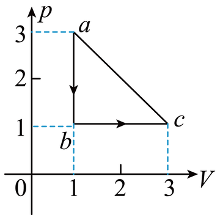

# Physics - 题目 2178

**ID**: 6998af5b05444f768301fe21c1b1c944
**年级**: Grade 12
**难度**: Medium
**题型**: Multiple-select

## 题目
一定质量的理想气体沿如图所示箭头方向发生状态变化，则下列说法正确的是（      ）​​​​​​​‌

## 解答

1. AC：由图像可知，bc过程气体压强不变，体积变大，根据 $\frac {pV}{T}=C$ 可知气体温度升高，气体内能增大，由于体积变大，气体对外界做功，据热力学第一定律 $ΔU=W+Q$ ，可知气体吸收的热量大于气体对外做功值，A错误，C正确；
2. B：ab过程，气体体积不变，压强减小，根据 $\frac {pV}{T}=C$ 可知气体温度降低，内能减少，由于体积不变，说明外界对气体做功为0，根据热力学第一定律 $ΔU=W+Q$ ，可知气体对外放热，B正确；
3. D：ca过程，由图像可知 $pV$ 乘积先变大后变小，根据 $\frac {pV}{T}=C$ 可知气体温度先升高后降低，则气体内能先增大后减小，D错误；
4. E．完成一个循环过程，回到原来的状态，气体温度不变，气体内能不变，E正确。选BCE。

## 知识点

**中文**:
  - 热力学第一定律与理想气体状态方程的综合应用

**English**:
  - Integrated Application of 1st Law and Ideal Gas Law

---
