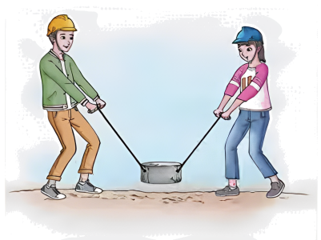

# Physics - 题目 488

**ID**: 746c6a2cf170485fa386fe0f8f5db2db
**年级**: Grade 12
**难度**: Medium
**题型**: Multiple-select

## 题目
人们有时用“打夯”的方式把松散的地面夯实。​​​​​​​‌设某次打夯符合以下模型：如图所示，两人同时通过绳子对质量为 $m$ 的重物分别施加大小均为 $mg$ （ $g$ 为重力加速度的大小）、方向都与竖直方向成 $37{}^\circ $ 的力，重物离开地面高度 $h$ 后人停止施力，最后重物自由下落砸入地面的深度为 $\frac {h}{10}$ 。 ${\rm{c}}{\rm{o}}{\rm{s}}37{}^\circ =0.8$ ，不计空气阻力，则（      ）

## 解答

1. C．设停止施力瞬间重物的速度大小为 $v{{}_{1}}$ ，根据动能定理有 $\left ({2F{\rm{c}}{\rm{o}}{\rm{s}}37{}^\circ -mg}\right )h=\frac {1}{2}mv{{}_{1}^{2}}$ ，则 $v{{}_{1}}=\sqrt {1.2gh}$ ，设重物刚落地时的速度大小为 $v{{}_{2}}$ ，根据动能定理有 $2F{\rm{c}}{\rm{o}}{\rm{s}}37{}^\circ \cdot h=\frac {1}{2}mv{{}_{2}^{2}}$ ，则 $v{{}_{2}}=\sqrt {3.2gh}$ ，C错误；
2. A．重物在空中运动过程，开始在拉力作用下做匀加速运动，速度大小达到 $v{{}_{1}}$ 后做匀减速运动直至速度为零，之后再做匀加速直线运动直至速度大小为 $v{{}_{2}}$ ，由此可知上升过程中的平均速度大小为 $v{{}_{1}}=\frac {v{{}_{1}}}{2}$ ，下降过程中的平均速度大小为 $\bar v{{}_{2}}=\frac {v{{}_{2}}}{2}$ ，又由于上升、下降位移大小相等，则重物在空中上升的时间一定大于在空中下落的时间，A正确；
3. B．重物在整个运动过程中，根据动能定理有 $W{{}_{入}}+W{{}_{{\rm{G}}}}-W{{}_{阻}}=0$ ，则重物克服地面阻力做的功大于人对重物做的功，B错误；
4. D．根据动能定理有 $2F{\rm{c}}{\rm{o}}{\rm{s}}37{}^\circ \cdot h+mg\frac {h}{10}-F{{}_{阻}}\frac {h}{10}=0$ ，则 $F{{}_{阻}}=17mg$ ，D正确。选AD。

## 知识点

**中文**:
  - 动能定理的简单应用

**English**:
  - Simple Applications of Work-Energy Theorem

---
