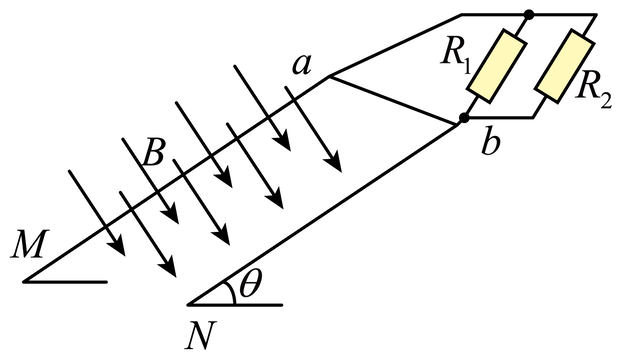

# Physics - 题目 2526

**ID**: 7e4bf603e0064b248c55c44d06b1c9af
**年级**: Grade 12
**难度**: Medium
**题型**: Multiple-select

## 题目
平行长直倾斜导轨M、N与水平面的夹角 $θ=30{}\degree $ ，这两条导轨之间存在垂直于导轨平面向下的匀强磁场，导轨间距 $L=1{\rm{m}},R{{}_{1}}$ 和 $R{{}_{2}}$ 是并联在导轨上端的电阻，且 $R{{}_{1}}=12Ω、R{{}_{2}}=6Ω$ ，导体棒ab垂直导轨M、N放置，其质量 $m=1{\rm{k}}{\rm{g}}$ ，各处导轨和导体棒之间的动摩擦因数均相同，如图。​​​​​​​‌从导体棒ab静止释放开始计时，刚释放时导体棒的加速度大小为 $0.25{\rm{m}}/{\rm{s}}{^{2}}$ ，当导体棒ab下滑的距离为20m时，其速度达到了最大值1m/s，之后它以这个速度匀速下滑。除 $R{{}_{1}},R{{}_{2}}$ 以外，其余部分的电阻均不计，设最大静摩擦力等于滑动摩擦力，重力加速度 $g=10{\rm{m}}/{\rm{s}}{^{2}}$ ．滑动过程中导体棒ab始终保持与导轨垂直且接触良好。由此可知（      ）

## 解答

1. A．由导体棒初始的加速度为 $a=0.25{\rm{m}}/{\rm{s}}{^{2}}$ ，可知 $mg{\rm{s}}{\rm{i}}{\rm{n}}θ-f=ma$ ，代入题中数据解得摩擦力大小 $f=4.75{\rm{N}}$ ，故A正确；
2. B．最终导体棒做匀速运动，速度 $v=1{\rm{m}}/{\rm{s}}$ ，设此时受到的安培力为 $F{{}_{安}}$ ，由力的平衡条件得 $mg{\rm{s}}{\rm{i}}{\rm{n}}θ-f-F{{}_{安}}=0$ ，而安培力 $F{{}_{安}}=BIL=B\cdot \frac {BLv}{R{{}_{总}}}\cdot L$ ，电路总电阻 $R{{}_{总}}=\frac {R{{}_{1}}R{{}_{2}}}{R{{}_{1}}+R{{}_{2}}}=4{\rm{Ω}}$ ，联立解得 $B=1{\rm{T}}$ ，故B错误；
3. C．导体棒达到最大速度时，导体棒合力为0，则 $mg{\rm{s}}{\rm{i}}{\rm{n}}θ-f-F{{}_{安}}=0$ ，可得，导体棒达到最大速度时所受安培力 $F{{}_{安}}=0.25{\rm{N}}$ ，由 $F{{}_{安}}=BIL$ ，解得导体棒中电流 $I=0.25{\rm{A}}$ ，故C错误；
4. D．对导体棒由能量守恒定律有 $\left ({mg{\rm{s}}{\rm{i}}{\rm{n}}θ-f}\right )x=\frac {1}{2}mv{^{2}}+Q$ ，代入题中数据，联立解得 $Q=4.5{\rm{J}}$ ，故D项正确。选AD 。

## 知识点

**中文**:
  - 导体切割磁感线产生感应电动势（电流）的分析与计算
  - 电磁感应现象中的功能问题

**English**:
  - Analysis and Calculation of Cutting Magnetic Field Lines
  - Work-Energy Problems in EM Induction

---
