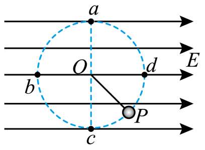

# Physics - 题目 798

**ID**: 89f241be5696436f88b94ef4e67c72d2
**年级**: Grade 12
**难度**: Medium
**题型**: Multiple-select

## 题目
如图所示，将绝缘细线的一端O点固定，另一端拴一带电的小球P，空间存在着方向水平向右的匀强电场E。​​​​​​​‌刚开始小球静止于P处，与竖直方向的夹角为45°，给小球一个瞬时冲量，让小球在竖直平面内做半径为r的圆周运动，下列分析正确的是（      ）

## 解答

1. A．由图可知电场力方向水平向右，与电场方向相同，所以小球带正电，故A错误；
2. B．小球静止于P处，与竖直方向的夹角为45°，受电场力和重力，合力方向斜向右下方45°，大小为
3. $F{\rm{=}}\sqrt {2}mg$
4. 当小球运动到弧ab中点，且细线弹力为零时
5. $F{\rm{=}}m\frac {v{^{2}}}{r}$
6. 小球能做完整的圆周运动，在该点的速度为
7. $v=\sqrt {\sqrt {2}gr}$
8. 小球从该点运动到a点，由动能定理得
9. $F\cdot \left ({r-\frac {r}{\sqrt {2}}}\right )=\frac {1}{2}mv{{}_{a}^{2}}-\frac {1}{2}mv{^{2}}$
10. 得
11. $v{{}_{a}}=\sqrt {\left ({3\sqrt {2}-2}\right )gr}$
12. 因此，当小球运动到最高点a的速度 $v{{}_{a}}\geqslant \sqrt {\left ({3\sqrt {2}-2}\right )gr}$ 时，小球才能做完整的圆周运动，故B错误；
13. C．小球运动过程中，重力势能、电势能、动能的总和保持不变，最低点的重力势能最小，则电势能与动能之和最大，故C正确；
14. D．小球从b运动到a的过程中，合力先做负功再做正功，故小球的速度先变小后变大，故D正确。
15. 故选CD。

## 知识点

**中文**:
  - 带电粒子（物体）在重力场和电场组成的复合场中的运动

**English**:
  - Motion in Gravity and Electric Composite Fields

---
