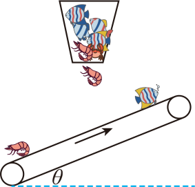

# Physics - 题目 2591

**ID**: 89f5a088ff9a4b27a58026060503da50
**年级**: Grade 12
**难度**: Medium
**题型**: Multiple-select

## 题目
渔业作业中，鱼虾捕捞上来后，通过“鱼虾分离装置”，实现了机械化分离鱼和虾，降低了人工成本。​​​​​​​‌某科学小组将“鱼虾分离装置”简化为如图所示模型，传送带与水平面的夹角 $θ$ ，分离器出口与顺时针运转的传送带有一定的高度差，鱼虾落在传送带上时只有沿着传送带向下的初速度（垂直带的速度瞬间为零），随后虾从传送带下方掉落，鱼从传送带上方掉落，实现分离。“虾”与传送带之间的动摩擦因数为 $μ{{}_{1}}$ ，“鱼”与传送带之间的动摩擦因数 $μ{{}_{2}}$ ，则（      ）

## 解答

1. AC：“虾”掉落到传送带后，有沿着传送带向下的初速度，受到的滑动摩擦力向上，如果摩擦力小于重力沿传送带向下的分力，则“虾”沿传送带向下做加速直线运动；如果摩擦力等于重力沿传送带向下的分力，则“虾”沿传送带向下做匀速直线运动；如果摩擦力大于重力沿传送带向下的分力，则“虾”沿传送带向下做减速直线运动；所以 $mg\sin θ$ 可能大于、等于或小于 $μ{{}_{1}}mg{\cos}θ$ ，则 $μ{{}_{1}}$ 可能小于、等于或大于 ${\tan}θ{\rm ，A}$ 正确，C错误；
2. BD：“鱼”掉落到传送带后，有沿着传送带向下的初速度，受到的滑动摩擦力向上，由题意可知，“鱼”先向下做减速运动到速度为0后，再向上做加速运动，则一定有 $m^{′}g\sin θ<μ{{}_{2}}m^{′}g{\cos}θ$ ，可得 $μ{{}_{2}}>{\tan}θ{\rm ，B}$ 错误，D正确。选AD。

## 知识点

**中文**:
  - 传送带模型

**English**:
  - Conveyor Belt Model

---
