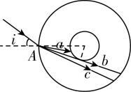

# Physics - 题目 2830

**ID**: 8a8db147c8884d58a5caa85d88db2396
**年级**: Grade 12
**难度**: Medium
**题型**: Multiple-select

## 题目
“天宫课堂”第四课在中国空间站开讲，航天员“太空教师”景海鹏、朱扬柱、桂海潮为广大青少年带来一场精彩的太空科普课。​​​​​​​‌如图甲所示，航天员在天宫课堂上演示了微重力环境下的神奇现象。液体呈球状，往其中央注入空气，可以在液体球内部形成一个同心球形气泡，如图乙所示,假设此液体球内、外半径之比为 $1:3$ ，当由 $a$ 、 $b$ 、 $c$ 三种颜色的光组成的细光束在过球心的平面内，从 $A$ 点以 $i={37}^{\circ }$  的入射角射入球中，其中 $b$ 光的折射光线刚好与液体球内壁相切，已知真空中光速为 $3×{10}^{8}\mathrm{m}/\mathrm{s}$ ，则下列说法正确的是甲    	乙（      ）

## 解答

1. 根据题图可知 $a$ 光的折射角小于 $c$ 光的折射角，则该液体材料对 $a$ 光的折射率大于对 $c$ 光的折射率， $\mathrm{A}$ 错误；若继续增大入射角 $i$ ， $b$ 光的折射角也将增大，光线将远离同心球形气泡，光线从液体材料射出时的入射角与射入液体材料时的折射角大小相等，根据光路的可逆性可知不会发生全反射， $b$ 光肯定能从液体球中射出， $\mathrm{B}$ 正确；根据几何关系可知， $b$ 光折射角的正弦值为 $\sin {r}_{b}=\frac{1}{3}$ ，根据折射定律可知，该液体材料对 $b$ 光的折射率为 ${n}_{b}=\frac{\sin i}{\sin {r}_{b}}=\frac{\sin {37}^{\circ }}{\frac{1}{3}}=\frac{9}{5}$ ，由题图可知 $a$ 光的折射角小于 $b$ 光的折射角，则该液体材料对 $a$ 光的折射率大于对 $b$ 光的折射率，由于 $\frac{6\sqrt{3}}{5}>\frac{9}{5}={n}_{b}$ ，因此该液体材料对 $a$ 光的折射率可能为 $\frac{6\sqrt{3}}{5}$ ， $\mathrm{C}$ 正确；根据光速与折射率之间的关系有 $v=\frac{c}{n}$ ，则 $b$ 光在液体球中的传播速度为 ${v}_{b}=\frac{c}{{n}_{b}}=\frac{3×{10}^{8}}{\frac{9}{5}}\mathrm{m}/\mathrm{s}=\frac{5}{3}×{10}^{8}\mathrm{m}/\mathrm{s}$ ，由题图可知 $c$ 光的折射角大于 $b$ 光的折射角，则该液体球对 $c$ 光的折射率小于对 $b$ 光的折射率，而折射率越小，光在该液体球中的传播速度越大，因此 $c$ 光在液体球中的传播速度一定大于 $\frac{5}{3}×{10}^{8}\mathrm{m}/\mathrm{s}$ ， $\mathrm{D}$ 错误。

## 知识点

**中文**:
  - 全反射与折射的综合应用

**English**:
  - Comprehensive Application of Total Reflection and Refraction

---
