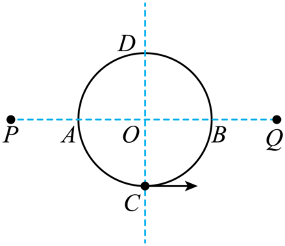

# Physics - 题目 1744

**ID**: a1edfbbe821d444090365aa40001c91c
**年级**: Grade 12
**难度**: Medium
**题型**: Multiple-select

## 题目
如图所示，同一水平线上的P、Q两点固定电荷量分别为 $+Q$ 和 $-Q$ 的点电荷，P、Q连线中点为O。​​​​​​​‌以O为圆心、R为半径的光滑绝缘细圆环固定在竖直平面内，与P、Q连线分别相交于A、B两点，一个质量为m、带电量为q的带电小球套在细环上，在最低点C以大小为 $v{{}_{0}}$ 的初速度向右运动，运动到B点时速度大小与在C点的速度大小相等，小球绕圆环在竖直面内做完整的圆周运动，不计小球的大小，下列说法正确的是（      ）

## 解答

1. A．根据动能定理，小球从 $C$ 到 $B$ 合力做功为零，重力做负功，则电场力做正功，则小球带正电，A正确；
2. B．根据静电场分布特点可知， $P、Q$ 连线的垂直平分线为等势面，小球在P、Q两点的电势能相同，因此小球在 $D$ 点和在 $C$ 点机械能相等，B错误；
3. C．A点电势较高，小球在A点的电势能较大，小球在A、B两点的重力势能相同，根据能量守恒，小球在 $A$ 点动能小于在 $B$ 点动能，根据向心加速度公式可知，在 $A$ 点向心加速度小，向心加速度与重力加速度的合加速度也小，C错误；
4. D．根据对称性 $U{{}_{AB}}=2U{{}_{OB}}$ ，根据动能定理 $qU{{}_{OB}}-mgR=0$ ，解得 $U{{}_{OB}}=\frac {mgR}{q}$ ，则 $U{{}_{AB}}=\frac {2mgR}{q}{\rm ，D}$ 正确。选AD。

## 知识点

**中文**:
  - 带电粒子（物体）在重力场和电场组成的复合场中的运动

**English**:
  - Motion in Gravity and Electric Composite Fields

---
