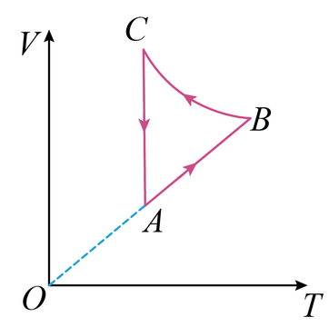

# Physics - 题目 1490

**ID**: abca7d84e0d54ff785e5fd7febac0828
**年级**: Grade 12
**难度**: Medium
**题型**: Multiple-select

## 题目
一定质量的理想气体从状态A经过状态B、C又回到状态A，该过程的 $V-T$ 图像如图所示，其中 $AB$ 反向延长线过原点 ${\rm \mathit{O}，}CA$ 与纵轴平行， $B\to C$ 为绝热过程。​​​​​​​‌下列说法正确的是（      ）

## 解答

1. $A\to B$ 过程气体温度升高，气体分子热运动的平均速率增大，但不是所有分子热运动的速率均增大，A错误；根据理想气体状态方程 $pV=CT$ ，可知 $V=\frac {C}{p}T$ ， $B\to C$ 过程，图像中各点与原点连线的斜率增大，所以压强减小，单位时间碰撞单位面积器壁的平均力减小，B正确； $C\to A$ 过程，气体温度不变，内能不变，气体体积减小，外界对气体做功，根据热力学第一定律 $ΔU=Q+W$ ，外界对气体做的功等于气体向外界放出的热量，C错误； $A\to B\to C\to A$ 一个循环过程，内能变化量为 ${\rm 0，}p-V$ 图像如图所示，根据图线与横轴所围成的面积可知， $A\to B\to C$ 过程气体对外界做的功大于 $C\to A$ 过程外界对气体做的功，所以一个循环过程 $W<0$ ，根据热力学第一定律可知，一个循环过程 $Q>0$ ，所以 $A\to B$ 过程气体吸收的热量大于 $C\to A$ 过程放出的热量，D正确。
2. 

## 知识点

**中文**:
  - 气体分子运动的特点
  - 气体压强的微观解释
  - 热力学第一定律与理想气体状态方程的综合应用

**English**:
  - Characteristics of Gas Molecule Motion
  - Microscopic Explanation of Gas Pressure
  - Integrated Application of 1st Law and Ideal Gas Law

---
