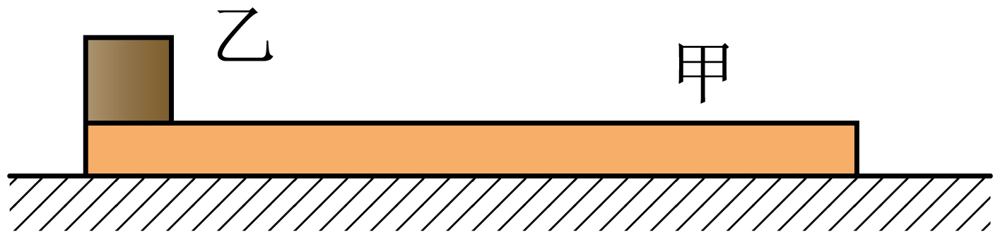

# Physics - 题目 1937

**ID**: b1577774021e4fa48b8dc8a235feb13a
**年级**: Grade 12
**难度**: Medium
**题型**: Multiple-select

## 题目
质量为 $m{{}_{1}}=2{\rm{k}}{\rm{g}}$ 、长度 $L=2{\rm{m}}$ 的长木板甲静止在光滑水平面上，一质量为 $m{{}_{2}}=1{\rm{k}}{\rm{g}}$ 的可视为质点的小物块乙放在长木板甲的左端，如图所示。​​​​​​​‌水平向右的拉力F，第一次作用在长木板甲右端，大小为6N，甲和乙刚要发生相对滑动；第二次作用在小物块乙的右侧，大小为7N。已知甲和乙之间的最大静摩擦力等于滑动摩擦力，重力加速度 $g=10{\rm{m}}{\rm{/}}{\rm{s}}{^{{{2}}}}$ 。拉力F第一次和第二次作用前，甲和乙如图示静止在水平面上。下列说法正确的是（      ）

## 解答

1. 水平拉力F第一次作用时，甲和乙刚要发生相对运动，对于甲和乙构成的整体，根据牛顿第二定律有 $a=\frac {F}{m{{}_{1}}+m{{}_{2}}}=2{\rm{m}}/{\rm{s}}{^{2}}$ ，故A错误；水平拉力F第一次作用时，对于物块乙有 ${\rm }{\rm μm}{{}_{2}}g=m{{}_{2}}a$ ，解得 $μ=\frac {a}{g}=0.2$ ，故B正确；水平拉力F第二次作用时，根据牛顿第二定律，对甲有 $a{{}_{1}}=\frac {{\rm μm}{{}_{2}}g}{m{{}_{1}}}=1{\rm{m}}/{\rm{s}}{^{2}}{\rm }$ ，对乙有 $a{{}_{2}}=\frac {F-{\rm μm}{{}_{2}}g}{m{{}_{2}}}=5{\rm{m}}{\rm{/}}{\rm{s}}{^{{{2}}}}$ ，经时间t，乙物块到达甲的右端，有 $L=\frac {1}{2}a{{}_{2}}t{^{2}}-\frac {1}{2}a{{}_{1}}t{^{2}}$ ，解得 $t=\sqrt {\frac {2L}{a{{}_{2}}-a{{}_{1}}}}=1{\rm{s}}$ ，故C正确；当乙滑动到甲的右端时，乙的速度为 $v{{}_{2}}=a{{}_{2}}t=5{\rm{m}}{\rm{/}}{\rm{s}}$ ，甲的速度为 $v{{}_{1}}=a{{}_{1}}t=1{\rm{m}}{\rm{/}}{\rm{s}}$ ，乙相对于甲的速度大小为 $v{{}_{相对}}=v{{}_{2}}-v{{}_{1}}=4{\rm{m}}{\rm{/}}{\rm{s}}$ ，故D错误。

## 知识点

**中文**:
  - 板块模型

**English**:
  - Plate Model

---
