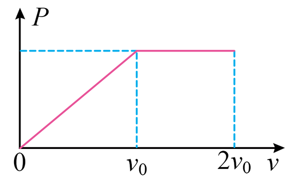

# Physics - 题目 2107

**ID**: b614e1254fb840fa8b741a8f35d29c84
**年级**: Grade 12
**难度**: Medium
**题型**: Multiple-select

## 题目
在汽车的设计研发中，需要测试发动机的性能。​​​​​​​‌汽车在倾角为 $θ$ 的长直斜坡上由静止启动，汽车的输出功率与速度的关系图像如题图，当汽车的速度增大到 $v{{}_{0}}$ 后保持最大功率不变，汽车能达到的最大速度为 $2v{{}_{0}}$ 。汽车的质量为m，汽车启动过程中所受摩擦阻力大小恒为f，不计空气阻力，重力加速度大小为g。下列说法正确的是（      ）

## 解答

1. A．根据物体的平衡条件可知，当汽车的速度大小为 $2v{{}_{0}}$ 时，汽车所受的牵引力大小为 $F{{}_{1}}=f+mg\sin θ$ ，因为在汽车的速度从 $v{{}_{0}}$ 增大到 $2v{{}_{0}}$ 的过程中，汽车发动机的功率均为最大功率，所以汽车发动机的最大功率 $P{{}_{{\rm \max }}}=F{{}_{1}}\cdot 2v{{}_{0}}$ ，解得 $P{{}_{{\rm{m}}{\rm{a}}{\rm{x}}{\rm{\;}}}}=2fv{{}_{0}}+2mgv{{}_{0}}\sin θ$ ，故A正确；B．设当汽车的速度大小为 $v{{}_{0}}$ 时，汽车所受的牵引力大小为 $F{{}_{2}}$ ，有 $P{{}_{{\rm \max }}}=F{{}_{2}}v{{}_{0}}$ ，设此时汽车的加速度大小为a，根据牛顿第二定律有 $F{{}_{2}}-f-mg\sin θ=ma$ ，解得 $a=\frac {f+mg\sin θ}{m}$ ，故B正确；C．在汽车的速度从0增大到 $v{{}_{0}}$ 的过程中，汽车做匀加速直线运动，加速时间 $t=\frac {v{{}_{0}}}{a}=\frac {mv{{}_{0}}}{f+mg\sin θ}$ ，故C正确；D．该过程汽车通过的位移大小 $x{{}_{1}}=\frac {v{{}_{0}}{^{2}}}{2a}=\frac {mv{{}_{0}}{^{2}}}{2(f+mg\sin θ)}$ ，设该过程汽车发动机做的功为W，根据动能定理有 $W-mgx{{}_{1}}\sin θ-fx{{}_{1}}=\frac {1}{2}mv{{}_{0}}{^{2}}$ ，解得 $W=mv{{}_{0}}{^{2}}$ ，故D错误。故选ABC。

## 知识点

**中文**:
  - 机车启动的两种方式

**English**:
  - Two Modes of Locomotive Start-up

---
