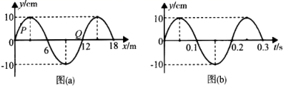

# Physics - 题目 724

**ID**: b8f28f876b2d4c40a63ec91d1d521605
**年级**: Grade 12
**难度**: Medium
**题型**: Multiple-select

## 题目
图（a）是一列简谐横波在t=0.10s时刻的波形图，P是平衡位置在x=1.5m处的质点，Q是平衡位置在x=12m处的质点；图（b）为质点Q的振动图像，下列说法正确的是（      ）。​​​​​​​‌

## 解答

1. A. 根据振动图像可知t=0.10s时刻质点Q向下振动，在波动图像中根据“同侧法”知波沿x轴正方向传播，A正确；
2. B. 由振动图像读出周期T=0.2s，从t=0.10s到t=0.25s经过的时间为
3. △t=0.15s= $ \frac {3}{4}$T
4. 则在t=0.25s时，质点P位于x轴上方，加速度方向沿y轴负方向，B正确；
5. C. 从t=0.10s到t=0.25s经过的时间为 $ \frac {3}{4}$ 个周期，t=0.25s时刻质点Q位于波峰，质点Q的位移大小为0.10m，路程为0.30m，C错误；
6. D. 从t=0.10s到t=0.25s经过的时间为 $ \frac {3}{4}$ 个周期，t=0.10s和t=0.25s质点P的瞬时速度不相同，由动量定理
7. $I=mΔv=m(v{{}_{2}}-v{{}_{1}})\ne 0$
8. 回复力对质点P的冲量不为零，D错误；
9. E.由振动图像和波动图像可知
10. $A=0.10{\rm{m}}$
11. $ω=\frac {2π}{T}=10π{\rm{r}}{\rm{a}}{\rm{d}}{\rm{/}}{\rm{s}}$
12. 质点Q简谐运动的表达式为
13. $y=A{\sin}ωt=0.10{\sin}10πt({\rm{m}})$
14. E正确。
15. 故选ABE。

## 知识点

**中文**:
  - 波的图像和振动图像的综合应用

**English**:
  - Integrated Application of Wave and Vibration Graphs

---
