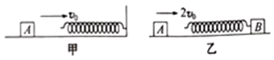

# Physics - 题目 1584

**ID**: b9617c0baac942fbbc389c37356eddba
**年级**: Grade 12
**难度**: Medium
**题型**: Multiple-select

## 题目
如图甲所示在光滑水平面上轻质弹簧一端固定。​​​​​​​‌物体A以速度v_{0}向右运动压缩弹簧测得弹簧的最大压缩量为x。现让该弹簧一端连接另一质量为2m的物体B（如图乙所示），静止在水平面上。物体A以2v_{0}的速度向右压缩弹簧测得弹簧的最大压缩量仍为x。则

## 解答

1. 当弹簧固定时，当弹簧压缩量最大时，弹性势能最大，A的动能转化为弹簧的弹性势能，根据系统的机械能守恒得：弹簧被压缩过程中最大的弹性势能等于A的初动能，设A的质量为m_{A}，即有：  ${\rm{E}}{{}_{{\rm{p}}{\rm{m}}}}=\frac {1}{2}m{{}_{A}}v{{}_{0}^{2}}$      ①
2. 当弹簧一端连接另一质量为m的物体B时，A与弹簧相互作用的过程中B将向右运动，A、B速度相等时，弹簧的弹性势能最大，选取A的初速度的方向为正方向，由动量守恒定律得：m_{A}•2v_{0}=（2m+m_{A}）v，②
3. 由机械能守恒定律得： $\vartriangle {\rm{E}}{{}_{{\rm{p}}{\rm{m}}}}=\frac {1}{2}m{{}_{A}}{\left({2v{{}_{0}}}\right)^{2}}-\frac {1}{2}\left ({m{{}_{A}}+2m}\right )v{^{2}}$ ③
4. 联立得：m_{A}=6m④
5. 联立①④得：E_{pm}=3mv_{0}^{2}
6. 弹簧压缩最大时B的动量为2mv=3mv_{0}
7. 故ACD正确，B错误。

## 知识点

**中文**:
  - 动量和能量的综合应用
  - 动量守恒与弹簧相结合

**English**:
  - Integration of Momentum and Energy
  - Momentum Conservation with Springs

---
