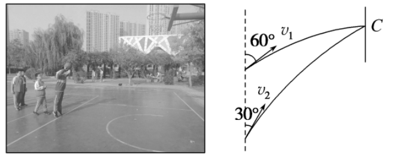

# Physics - 题目 2512

**ID**: bc6e79831b64446eac74ee34adbda9be
**年级**: Grade 12
**难度**: Medium
**题型**: Multiple-select

## 题目
如图所示，一学生做定点投篮游戏.​​​​​​​‌第一次出手，篮球的初速度方向与竖直方向的夹角 $α=60^\circ $ ；第二次出手，篮球的初速度方向与竖直方向的夹角 $β=30^\circ $ ；两次出手的位置在同一竖直线上，结果两次篮球正好垂直撞击到篮板同一位置点.不计空气阻力，则从篮球出手到运动到点 $C$ 的过程中，下列说法正确的是（      ）

## 解答

1. 对第一次出手，有 ${\tan}30^\circ =2\frac {y{{}_{1}}}{x}$ ，对第二次出手，有 ${\tan}60^\circ =2\frac {y{{}_{2}}}{x}$ ，联立可得 $\frac {y{{}_{1}}}{y{{}_{2}}}=\frac {1}{3}$ ，且对第一次出手，有 $y{{}_{1}}=\frac {1}{2}gt{{}_{1}^{2}}$ ，对第二次出手，有 $y{{}_{2}}=\frac {1}{2}gt{{}_{2}^{2}}$ ，联立可得 $\frac {t{{}_{1}}}{t{{}_{2}}}=\frac {1}{\sqrt {3}}$ ，A正确，B错误；对第一次出手，有 $\frac {v{{}_{y1}}}{2}\cdot t{{}_{1}}=y{{}_{1}},v{{}_{1}}=\frac {v{{}_{y1}}}{{\sin}30^\circ }$ ， $v{{}_{x1}}=\frac {v{{}_{y1}}}{{\tan}30^\circ }$ ，对第二次出手，有 $\frac {v{{}_{y2}}}{2}\cdot t{{}_{2}}=y{{}_{2}},\quad v{{}_{2}}=\frac {v{{}_{y2}}}{{\sin}60^\circ },\quad v{{}_{x2}}=\frac {v{{}_{y2}}}{{\tan}60^\circ }$ ，联立可得 $v{{}_{1}}=v{{}_{2}},\quad v{{}_{x1}}=\sqrt {3}v{{}_{x2}}$ ，因二者初速度相同，则初动能相同，但速度在水平方向上的分量不同，则打在篮板上的末速度不同，则在 $C$ 点时，两球的机械能不同，C正确， ${\rm{D}}$ 错误.

## 知识点

**中文**:
  - 斜抛运动

**English**:
  - Oblique Projectile Motion

---
