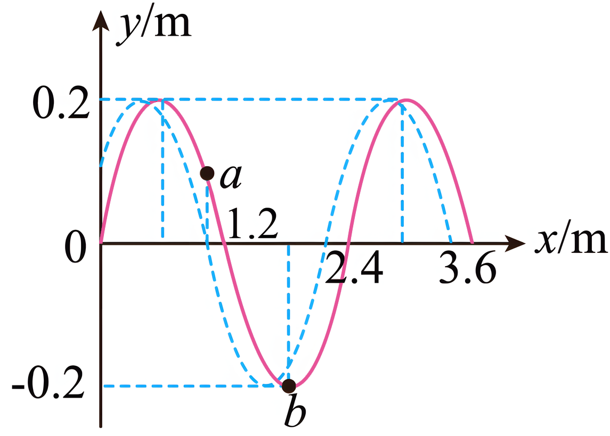

# Physics - 题目 2898

**ID**: c3c64d397b934914ba832615851548b8
**年级**: Grade 12
**难度**: Medium
**题型**: Multiple-select

## 题目
如图为一列沿x轴传播的简谐横波，t=0时刻的波形如图中实线所示，经0.​​​​​​​‌2s波形第一次变为图中虚线所示，已知a为平衡位置在x=1.0m处的质点，b为平衡位置在x=1.8m处的质点，则下列说法正确的是（      ）

## 解答

1. AB．由图可知，波长为 $λ=2.4{\rm{m}}$ ，如果波沿x轴正方向传播，波速为 $v=\frac {x}{t}=\frac {2.2}{0.2}{\rm{m}}{\rm{/}}{\rm{s}}=11{\rm{m}}{\rm{/}}{\rm{s}}$ ，波的周期为 $T=\frac {λ}{v}=\frac {2.4}{11}{\rm{s}}=\frac {12}{55}{\rm{s}}$ ，如果波沿x轴负方向传播，波速为 $v=\frac {x}{t}=\frac {0.2}{0.2}{\rm{m}}{\rm{/}}{\rm{s}}=1{\rm{m}}{\rm{/}}{\rm{s}}$ ，波的周期为 $T=\frac {λ}{v}=\frac {2.4}{1}{\rm{s}}=2.4{\rm{s}}$ ，A正确，B错误；
2. C．如果波沿x轴正方向传播，则t=0时刻，质点a沿y轴正方向振动，质点a比b后回到平衡位置，C正确；
3. D．如果波沿x轴负方向传播，则t=0时刻平衡位置在x=3.0m处质点的振动形式传播到x=1.0m处时，质点a第一次到波峰，即波沿x轴负方向传播2.0m，用时2s，D正确；
4. E．机械波在传播过程中，各质点只在平衡位置附近振动，质点并不随波迁移，E错误。选ACD。

## 知识点

**中文**:
  - 波的图像及其应用

**English**:
  - Wave Graphs and Applications

---
