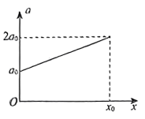

# Physics - 题目 1897

**ID**: cac8f972ff25450fb79f67a5028f0ffe
**年级**: Grade 12
**难度**: Medium
**题型**: Multiple-select

## 题目
空间存在着沿x轴方向的电场，取x轴正方向为电场的正方向。​​​​​​​‌将一个质量为m、电荷量为 $-q$ 的粒子从坐标原点O由静止释放，其加速度a随位置x变化的图像如图所示，不计粒子重力，则下列说法正确的是（      ）

## 解答

1. A．不计粒子重力，粒子仅受电场力，由牛顿第二定律 $qE=ma$ ，由图可知，粒子运动到 $x{{}_{0}}$ 位置的过程中，粒子的加速度不断增大，则场强不断增大，该电场为非匀强电场，A错误；
2. B．粒子运动到 $x{{}_{0}}$ 位置的过程中由动能定理 $W{{}_{电}}=F{{}_{电}}x{{}_{0}}=\frac {1}{2}mv{^{2}}-0$ ，由 $a-x$ 图像的图线与坐标轴围成的面积意义可知 $F{{}_{电}}x{{}_{0}}=ma\cdot x{{}_{0}}=m\cdot \frac {(a{{}_{0}}+2a{{}_{0}})}{2}x{{}_{0}}$ ，联立解得，此时粒子的速度为 $v=\sqrt {3a{{}_{0}}x{{}_{0}}}$ ，B正确；
3. C．粒子运动到 $x{{}_{0}}$ 位置时，电场力对粒子做功的功率为 $P=F{{}_{电}}v=m\times 2a{{}_{0}}v=2ma{{}_{0}}\sqrt {3a{{}_{0}}x{{}_{0}}}$ ，C错误；
4. D．从O到 $x{{}_{0}}$ 的过程，电场力做的功为 $W{{}_{电}}=F{{}_{电}}x{{}_{0}}=m\cdot \frac {(a{{}_{0}}+2a{{}_{0}})}{2}x{{}_{0}}=\frac {3ma{{}_{0}}x{{}_{0}}}{2}$ ，根据电场力做功与电势能的关系 $W{{}_{电}}=-ΔE{{}_{{\rm{p}}}}$ ，可得粒子的电势能减小 $\frac {3ma{{}_{0}}x{{}_{0}}}{2}$ ，D正确。选BD。

## 知识点

**中文**:
  - 电势能与静电力做功

**English**:
  - Electric Potential Energy and Work Done by Electrostatic Force

---
