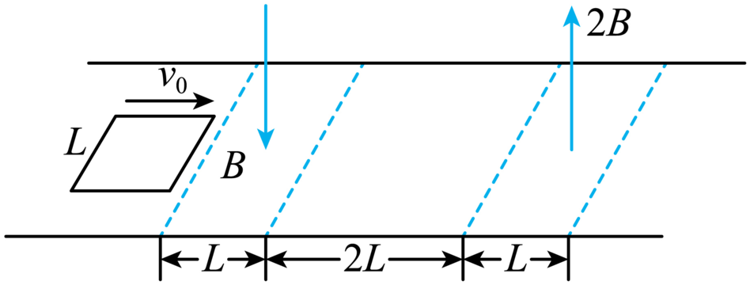

# Physics - 题目 2264

**ID**: cd50f09283144b60abc6a3c6e08ca76e
**年级**: Grade 12
**难度**: Medium
**题型**: Multiple-select

## 题目
如图所示，水平粗糙地面上有两磁场区域，左右两磁场区域内的匀强磁场宽度均为L，磁感应强度大小分别为B和2B，左磁场区磁场方向竖直向下，右磁场区磁场方向竖直向上，两磁场间距为2L。​​​​​​​‌一个质量为m、匝数为n、电阻为R、边长为L的正方形金属线框以速度v0水平向右进入左磁场区域，当金属线框刚离开右磁场区域时速度为 $v{{}_{1}}$ ，金属线框离开右磁场区运动一段距离后停下、金属线框与水平面间的动摩擦因数为μ。关于金属线框的运动下列判断正确的是（      ）

## 解答

1. A．由法拉第电磁感应定律可知，平均感应电动势
2. $\bar E=n\frac {ΔΦ}{Δt}$
3. 由闭合电路欧姆定律可知，平均感应电流
4. $\bar I=\frac {\bar E}{R}$
5. 通过金属线框的电荷量
6. $q=\bar IΔt$
7. 联立得
8. $q=n\frac {\Delta Φ}{R}$
9. 金属线框穿过右磁场区域过程中通过金属线框的磁通量变化量
10. $\Delta Φ=0$
11. 则金属线框穿过右磁场区域过程中通过金属线框的电荷量为0，故A正确；
12. B．金属线框穿过磁场区域时，由于速度减小，则产生的感应电动势减小，导致安培力减小，做加速度减小的变减速直线运动，故B错误；
13. C．设金属线框通过两个磁场区域全过程中产生的焦耳热为Q，金属线框从开始运动到离开右磁场区域过程，由能量守恒定律得
14. $\frac {1}{2}mv{{}_{0}^{2}}={\rm μm}g(L+2L+L+L)+\frac {1}{2}mv{{}_{1}^{2}}+Q$
15. 解得
16. $Q=\frac {1}{2}mv{{}_{0}^{2}}-\frac {1}{2}mv{{}_{1}^{2}}-5{\rm μm}gL$
17. 故C正确；
18. D．金属线框进入左侧磁场过程中穿过金属线框的磁通量
19. $ΔΦ=BL{{}^{2}}$
20. 通过金属线框的电荷量
21. $q=\frac {nΔΦ}{R}=\frac {nBL{{}^{2}}}{R}$
22. 设金属线框刚好完全进入左侧磁场区域时的速度大小为v，该过程，对金属线框，由动量定理得
23. $-B\bar ILt-{\rm μm}gt=mv-mv{{}_{0}}$
24. 其中
25. $\bar It=q$
26. 解得
27. $v=v{{}_{0}}-μgt-\frac {nB{{}^{2}}L{{}^{3}}}{mR}$
28. 故D正确。
29. 故选ACD。

## 知识点

**中文**:
  - 线框模型

**English**:
  - Wire Frame Model

---
