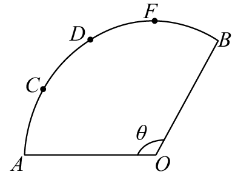

# Physics - 题目 348

**ID**: cda136dc90e74775a8b6afd55dba7fdb
**年级**: Grade 12
**难度**: Medium
**题型**: Multiple-select

## 题目
匀强电场中有一与电场方向平行的扇形AOB区域，如图所示，圆心角 $θ=120{}^\circ $ ，半径 $R=1{\rm{m}}$ ，其中C、D、F将圆弧AB四等分。​​​​​​​‌已知 $φ{{}_{A}}=9{\rm{V}}$ ， $φ{{}_{B}}=0$ ， $φ{{}_{O}}=3{\rm{V}}$ ，以下说法正确的是（      ）

## 解答

1. AB．连接AB、OC、OD、OE，交点分别为I、H、G， $\vartriangle OIG$ 为等边三角形， $\vartriangle OAI$ 、 $△OBG$ 为等腰三角形，如图所示
2. 
3. 由几何关系可得
4. AI=IG=GB
5. 即I、G为AB的三等分点，由于匀强电场电势均匀变化，可得
6. $φ{{}_{I}}=6{\rm{V}}$ ， $φ{{}_{G}}=3{\rm{V}}$
7. 故OF为电势3V的等势面，由几何关系可得DI连线垂直于OA，与OF平行，为电势6V的等势面，即
8. $φ{{}_{D}}=6{\rm{V}}$ ， $φ{{}_{F}}=3{\rm{V}}$
9. AB正确；
10. C．电场方向垂直于等势面指向电势较低一侧，故沿AO连线方向，C正确；
11. D．场强大小为
12. $E=\frac {U{{}_{AO}}}{R}=6{\rm{V}}{\rm{/}}{\rm{m}}$
13. D错误。
14. 故选ABC。

## 知识点

**中文**:
  - 电场线和等势面的关系

**English**:
  - Relationship between Field Lines and Equipotential Surfaces

---
