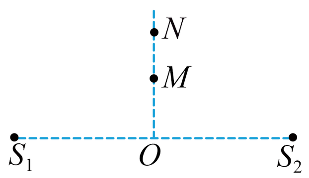

# Physics - 题目 1617

**ID**: d19e06662e3542d8abf652f207c8913d
**年级**: Grade 12
**难度**: Medium
**题型**: Multiple-select

## 题目
如图所示，开阔的平静水面上，在相距2.​​​​​​​‌4m的S₁、S₂有两振动情况完全相同的波源，形成波长均为0.4m的简谐波沿水面传播.S₁、S₂连线的中点为O，连线中垂线上两点M、N到O的距离分别为0.5m、0.9 m.各处振动稳定后，下列说法正确的是（      ）

## 解答

1. M、N处到两波源距离差为零，所以均为振动加强点，故A正确；因为 $Δx=S{{}_{1}}N-S{{}_{1}}M=0.{{2}}{\rm{m}}$ ，当M处出现波峰时，两波源的波峰传到M点，且两点距离波源差半个波长，此时两波源的波谷传到N点，所以N处出现波谷，故B错误，C正确；根据以上分析可知，两点距离波源差半个波长，最多出现1个波峰，故D错误.

## 知识点

**中文**:
  - 波的加强点与减弱点相关问题

**English**:
  - Constructive and Destructive Interference Points

---
