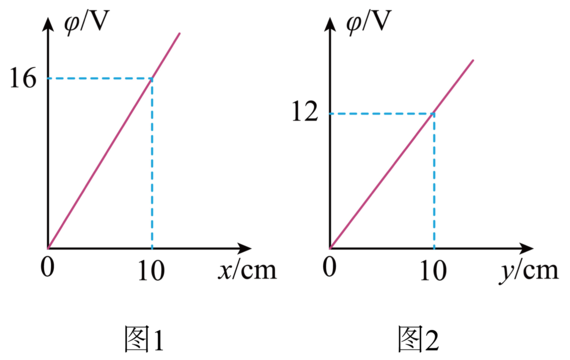

# Physics - 题目 260

**ID**: d827c724e56d420eb4c88ff9bc8a393e
**年级**: Grade 12
**难度**: Medium
**题型**: Multiple-select

## 题目
空间内有一与纸面平行的匀强电场，为研究该电场，在纸面内建立直角坐标系。​​​​​​​‌规定坐标原点的电势为0，测得x轴和y轴上各点的电势如图1、2所示。下列说法正确的是（      ）

## 解答

1. A．由图像斜率可知电场在x轴和y轴上的分电场分别为
2. $E{{}_{x}}=\frac {\Delta φ{{}_{x}}}{\Delta x}=\frac {16}{0.1}{\rm V}$ /m=160V/m
3. $E{{}_{y}}=\frac {\Delta φ{{}_{y}}}{\Delta y}=\frac {12}{0.1}{\rm V}$ /m=120V/m
4. 则电场大小为
5. $E=\sqrt {E{{}_{x}^{2}}+E{{}_{y}}{^{2}}}={\rm 200V}$ /m
6. 故A错误；
7. B．电场强度的方向与x轴负方向夹角的正切值为
8. ${\tan}α=\frac {E{{}_{y}}}{E{{}_{2}}}=\frac {3}{4}$
9. 故B正确；
10. C．规定坐标原点的电势为0，点（10cm，10cm）处的电势为
11. $φ=Ed=200\times 10\sqrt {2}{\cos}(45{}\degree -37{}\degree )\times 0.01{\rm V=28V}$
12. 故C错误；
13. D．纸面内距离坐标原点10cm的各点电势最高为
14. $φ^{′}=Ed^{′}=200\times 10\times 0.01{\rm V=20V}$
15. 故D正确；
16. 故选BD。

## 知识点

**中文**:
  - 静电场中的图像问题

**English**:
  - Graph Problems in Electrostatic Fields

---
