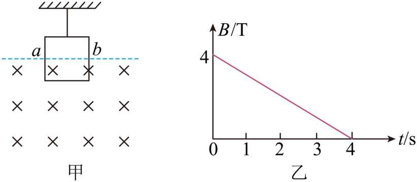

# Physics - 题目 1621

**ID**: dd266e3398a8483a9a7a7c130add0fb4
**年级**: Grade 12
**难度**: Medium
**题型**: Multiple-select

## 题目
如图甲所示，轻质细线吊着正方形闭合线圈 （上、下边均水平），正方形线圈左右两边中点a、b连线以下区域处于垂直纸面向里的匀强磁场中，匀强磁场的磁感应强度B的大小随时间t的变化关系如图乙所示。​​​​​​​‌正方形线圈的质量m=0.5kg、边长L=0.5m、匝数n=4、总电阻r=2Ω, 取重力加速度大小  $g=10{\rm{m}}/{\rm{s}}²,$ 下列说法正确的是（      ）

## 解答

1. A．由楞次定律可判断感应电流沿顺时针方向，A错误；
2. B．正方形线圈中产生的感应电动势为 $E=n\frac {\Delta Φ}{\Delta t}=n\frac {\Delta B}{\Delta t}\cdot \frac {L{^{2}}}{2}=0.5$ V，B正确；
3. CD．正方形线圈中产生的电流为  $I=\frac {E}{r}=0.25$ A，根据楞次定律可知线圈中电流为顺时针方向，线圈受到的安培力向下，根据受力平衡可得F=mg+nBIL，由B-t图像可知，t= 2s时磁感应强度大小为B=2T，联立解得t= 2s时细线对正方形线圈的拉力大小为F=6N，C错误，D正确。选BD。

## 知识点

**中文**:
  - 电磁感应定律中的图像问题

**English**:
  - Graph Problems in EM Induction

---
