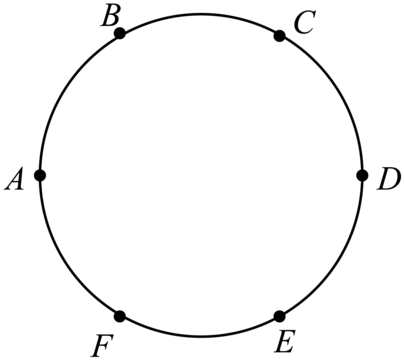

# Physics - 题目 221

**ID**: dec596c45f5141e59fb5c20323cb319e
**年级**: Grade 12
**难度**: Medium
**题型**: Multiple-select

## 题目
如图所示，在竖直平面内有A、B、C、D、E、F六个点均匀分布在半径为 $R=\sqrt {3}{\rm{m}}$ 的圆周上，直径AD水平，空间有一电场方向与圆平面平行的匀强电场。​​​​​​​‌已知 $φ{{}_{A}}=(2-\sqrt {3}){\rm{V}}$ ， $φ{{}_{B}}=2{\rm{V}}$ ， $φ{{}_{C}}=(2+\sqrt {3}){\rm{V}}$ ，重力加速度 $g=10{\rm{m}}{\rm{/}}{\rm{s}}{^{2}}$ ，下列判断正确的是（      ）

## 解答

1. 如图所示
2. 
3. 设AC连线的中点为P，根据题意有 $φ{{}_{P}}=\frac {φ{{}_{A}}+φ{{}_{C}}}{2}=2{\rm{V}}=φ{{}_{B}}$ ，由此可知，BP为等势线，AC为电场线，且电场的方向由高电势指向低电势，即由C指向A，A正确；负电荷由B点经D点移到E点，电势先升高后降低，所以电势能先减小后增大，B错误；若粒子能到达图中的Q点，则可以达到圆上任意位置，假设粒子由B运动到Q，根据动能定理有 $qU{{}_{BQ}}=E{{}_{{\rm{k}}Q}}-E{{}_{{\rm{k}}B}}$ ， $U{{}_{BQ}}=-ER=-2{\rm{V}}$ ，解得 $E{{}_{{\rm{k}}Q}}=0$ ，粒子由B运动到Q做类抛运动，粒子到Q点速度不为零，动能不为零，假设不成立，C错误；从B点到E点，根据动能定理 $mg\cdot BF+qU{{}_{BE}}=E{{}_{{\rm{k}}E}}-E{{}_{{\rm{k}}{{0}}}}$ ， $BF=2R{\cos}θ=3{\rm{m}}$ ， $U{{}_{BE}}=0$ ，解得 $E{{}_{{\rm{k}}E}}=8\times 10{^{-6}}{\rm{J}}{\rm ，D}$ 正确。

## 知识点

**中文**:
  - 电势差与电场强度的关系
  - 电势差与等势面的综合性问题

**English**:
  - Relationship between Potential Difference and Field Strength
  - Comprehensive Problems on Potential Difference and Equipotential Surfaces

---
