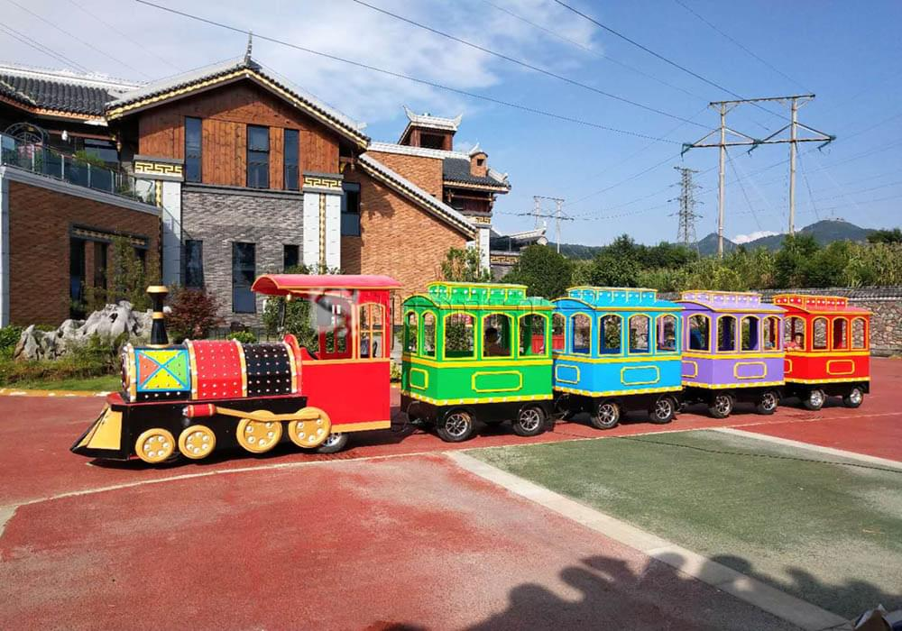

# Physics - 题目 727

**ID**: e2644bae06114f85a0fd66599b3675cc
**年级**: Grade 12
**难度**: Medium
**题型**: Multiple-select

## 题目
如图所示，游乐园的观光小火车特别受大家的喜爱。​​​​​​​‌现有一辆小火车由车头和4节车厢编组而成，假设车头和每一节车厢的质量均相等，在水平地面上运行过程中阻力与重力成正比。小火车在运动中，车头对第一节车厢的拉力为 $F{{}_{1}}$ ，第一节车厢对第二节车厢的拉力为 $F{{}_{2}}$ ，第二节车厢对第三节车厢的拉力为 $F{{}_{3}}$ ，第三节车厢对第四节车厢的拉力为 $F{{}_{4}}$ ，则（      ）

## 解答

1. 运行过程中阻力与重力成正比，设比例系数为k。设每一节车厢的质量为 $m$ ，小火车做匀加速直线运动时，对四节车厢整体进行分析，由牛顿第二定律有 $F{{}_{1}}-k\left ({4mg}\right )=4ma$ ，解得 $F{{}_{1}}=4m\left ({a+gk}\right )$ ，同理，对后三节车厢整体进行分析，有 $F{{}_{2}}=3m\left ({a+gk}\right )$ ，对后两节车厢进行分析，有 $F{{}_{3}}=2m\left ({a+gk}\right )$ ，对第四节车厢进行分析，有 $F{{}_{4}}=m\left ({a+gk}\right )$ ，由此可知，无论小火车做匀速直线运动还是匀加速直线运动，都有 $F{{}_{1}}:F{{}_{2}}:F{{}_{3}}:F{{}_{4}}=4:3:2:1$ 。故AC正确，BD错误。

## 知识点

**中文**:
  - 连接体问题（整体和隔离法）、临界问题

**English**:
  - Connected Bodies Problems (Whole/Isolation Method), Critical Problems

---
