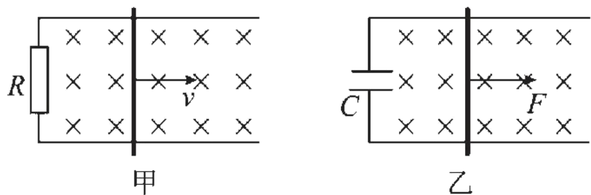

# Physics - 题目 822

**ID**: e68fa553e48c438aabc2e1f5abb9fdec
**年级**: Grade 12
**难度**: Medium
**题型**: Multiple-select

## 题目
如图所示，两足够长的水平光滑导轨置于竖直方向的匀强磁场中，左端分别连接一定值电阻和电容器，将两导体棒分别垂直放在两导轨上。​​​​​​​‌给甲图导体棒一水平向右的初速度 $v$ ，乙图导体棒施加水平向右的恒定拉力 $F$ 从静止开始运动。不计导轨及两棒电阻，两棒向右运动的过程中与导轨始终接触良好并始终与导轨垂直，下列说法正确的是（      ）

## 解答

1. 图甲中，导体切割磁感线产生感应电动势，则有 $E=BLv$ ， $I=\frac {E}{R}$ ，根据牛顿第二定律有 $BIL=ma$ ，又 $a=\frac {Δv}{Δt}$ ，则 $Δv=\frac {B{^{2}}L{^{2}}}{mR}vΔt=\frac {B{^{2}}L{^{2}}}{mR}x$ ，所以图甲中，导体棒速度的减小量与通过的距离成正比，故A错误，B正确；图乙中，设极短时间 $Δt$ 内，导体棒速度变化量为 $Δv$ ，则导体棒的加速度为 $a=\frac {Δv}{Δt}$ ，导体棒产生的电动势为 $E=BLΔv$ ，电容器增加的电荷量为 ${\rm{Δ}}q=CE=CBL{\rm{Δ}}v$ ，电流为 $I=\frac {Δq}{Δt}=CBLa$ ，导体又受到安培力为 $F{{}_{安}}=BIL=B{^{2}}L{^{2}}Ca$ ，根据牛顿第二定律 $F-F{{}_{安}}=ma$ ，解得 $a=\frac {F}{m+CB{^{2}}L{^{2}}}$ ， $Δv=\frac {F}{m+CB{^{2}}L{^{2}}}Δt$ ，可知图乙中，导体棒速度的增加量与运动时间成正比，故C正确，D错误。

## 知识点

**中文**:
  - 导体切割磁感线产生感应电动势（电流）的分析与计算

**English**:
  - Analysis and Calculation of Cutting Magnetic Field Lines

---
