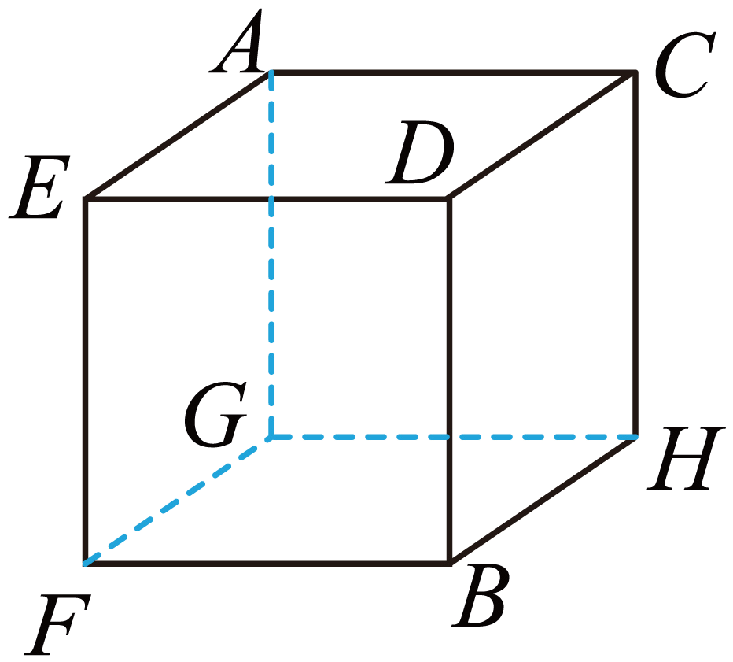

# Physics - 题目 911

**ID**: f8c6bb6607124ab6b73bef9a8f347ddd
**年级**: Grade 12
**难度**: Medium
**题型**: Multiple-select

## 题目
在边长为L的正方体顶点A、B处各固定一正点电荷，电荷量均为+Q，下列说法正确的是（      ）​​​​​​​‌

## 解答

1. A处点电荷在D点的电场强度 $E{{}_{AD}}=k\frac {Q}{(\sqrt {2}L){^{2}}}=\frac {kQ}{2L{^{2}}}{\rm ，\mathit{B}}$ 处点电荷在D点的电场强度 $E{{}_{BD}}=k\frac {Q}{L{^{2}}}{\rm ，A}$ 错误；A、B两处点电荷在D点、G点的合场强 $E{{}_{D}}=E{{}_{G}}=\frac {\sqrt {5}kQ}{2L{^{2}}}$ ，与AG边、BD边夹角均为 $α$ ，则 ${\tan}α=\frac {1}{2}{\rm ，B}$ 正确；在顶点F处放置一电荷量为 $-q$ 的试探电荷（不计重力），解除外力后，试探电荷的电势能越来越小，C错误；试探电荷在F处所受A、B两处点电荷合力 $F{{}_{F}}=\frac {\sqrt {5}kQq}{2L{^{2}}}$ ，若施加匀强电场，试探电荷受匀强电场电场力与F_{F}大小相等，方向相反，即可保持静止，此时匀强电场场强 $E{{}_{匀}}=\frac {\sqrt {5}kQ}{2L{^{2}}}{\rm ，D}$ 正确。

## 知识点

**中文**:
  - 点电荷的场强
  - 电势能与静电力做功

**English**:
  - Field Strength of Point Charge
  - Electric Potential Energy and Work Done by Electrostatic Force

---
