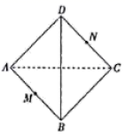

# Physics - 题目 1216

**ID**: fb1380f29809411cac71f0bd35ab9813
**年级**: Grade 12
**难度**: Medium
**题型**: Multiple-select

## 题目
如图所示，真空中有一正方形ABCD，M、N分别是AB和CD的中点，现在A、B两点分别固定电荷量为+Q、－Q的等量异种点电荷，下列说法中正确的是（      ）​​​​​​​‌

## 解答

1. AB．根据等量异种电荷的电场可知，MN为等势面，在MN的右侧电势为负值，而在MN的左侧，电势为正值，因此将试探电荷+q从M点移到N点，在等面上移动，电场力不做功，电势能不变；而将试探电荷－q从电势为负值的C点移到电势为正值的D点，电场力做正功，电势能减少，AB正确；
2. C．等势面与电场线垂直，因此N点的电场强度方向平行于AB，跟MN垂直，C正确；
3. D．根据对称性，C、D两点的电场强度大小相等，但方向不同，因此电场强度不相同，D错误。
4. 故选ABC。

## 知识点

**中文**:
  - 点电荷的场强

**English**:
  - Field Strength of Point Charge

---
