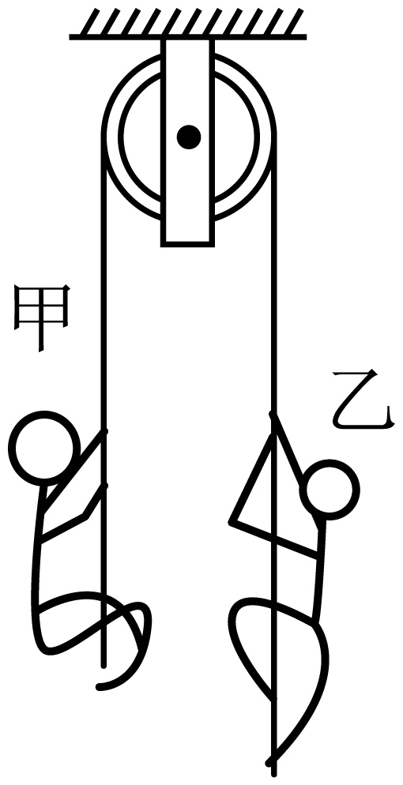

# Physics - 题目 2804

**ID**: fdbe9a9fc69a43658b49bb5841997a97
**年级**: Grade 12
**难度**: Medium
**题型**: Multiple-select

## 题目
如图所示，甲、乙两名质量分别为m_{1}和m_{2}的运动员，各抓住轻质绳的一端（运动员脚未着地），绳子与滑轮间的摩擦不计，滑轮和绳子质量均不计，则（      ）​​​​​​​‌

## 解答

1. B．对整体分析，有 $m{{}_{1}}g-m{{}_{2}}g=(m{{}_{1}}+m{{}_{2}})a$ ，对m_{1}，有 $m{{}_{1}}g-T=m{{}_{1}}a$ ，所以 $a=\frac {m{{}_{1}}-m{{}_{2}}}{m{{}_{1}}+m{{}_{2}}}g$ ， $T=\frac {2m{{}_{1}}m{{}_{2}}}{m{{}_{1}}+m{{}_{2}}}g$ ，B正确；
2. A．绳子质量不计时，运动员与绳子间的摩擦力大小等于绳子拉力大小，A错误；
3. CD．若 $m{{}_{1}}=m{{}_{2}}$ ，甲运动员抓住绳子由静止开始加速上爬，绳子拉力大于运动员的重力，绳子对两运动员的拉力大小相等，两运动员的质量也相等，所以两运动员向上的加速度大小相等，又起始高度相同，两运动员同时到达滑轮处，C正确，D错误。选BC。

## 知识点

**中文**:
  - 连接体问题（整体和隔离法）、临界问题

**English**:
  - Connected Bodies Problems (Whole/Isolation Method), Critical Problems

---
