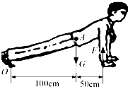

# Physics - 题目 2424

**ID**: 32b97f77724e492db9ab76c9172e605b
**年级**: Grade 8
**难度**: Easy
**题型**: Calculation

## 题目
如图所示，小华正在做俯卧撑，可以将他的身体看作一个杠杆，O为支点，A为他的重心，相关长度已在图中标明．已知他的质量m＝60kg，g＝10N/kg．（1）求小华受到的重力G；​​​​​​​‌（2）求图示时刻地面对双手的支持力F．

## 解答

1. （1）小华受到的重力：
2. G=mg=60kg×10N/kg=600N；
3. （2）过支点做支持力F的作用线的垂线段，即为其力臂，由图可知
4. L_{1}=100cm+50cm=150cm，
5. 如图所示：
6. 
7. 根据杠杆平衡的条件可得：
8. $\hspace{-0.5em}\begin{array}{l}FL{{}_{1}}=GL{{}_{2}}\\F\times 150{\rm{c}}{\rm{m}}=600{\rm{N}}\times 100{\rm{c}}{\rm{m}}\\F=400{\rm{N}}\end{array}\hspace{-0.5em}$
9. 答：（1）小华受到的重力G为600N；
10. （2）图示时刻地面对双手的支持力F为400N．

## 知识点

**中文**:
  - 杠杆平衡条件的应用

**English**:
  - Application of Lever Equilibrium Conditions

---
