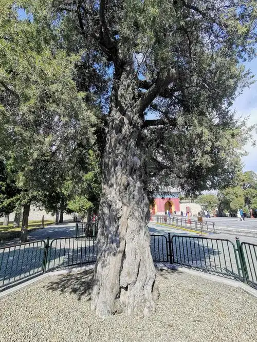
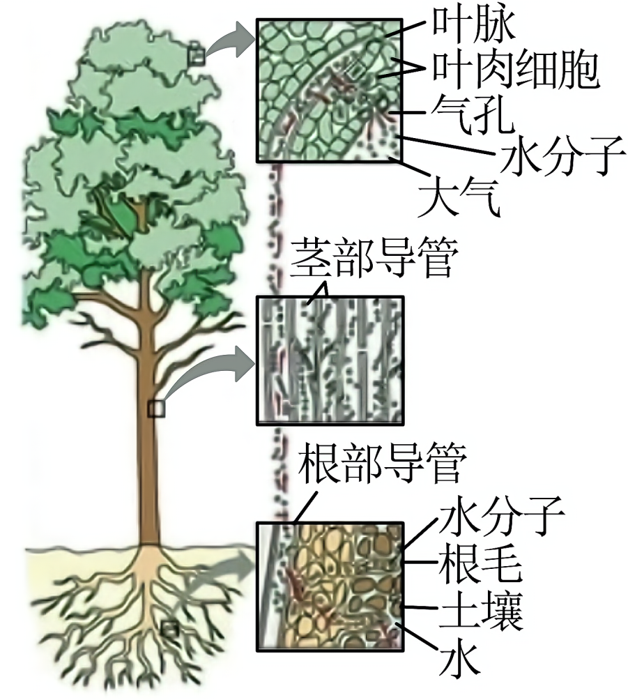

# Physics - 题目 568

**ID**: 99aa3cb42627410499e03e684d169c0f
**年级**: Grade 8
**难度**: Easy
**题型**: Calculation

## 题目
如图所示，是北京天坛古树中最著名的“九龙柏”，为明初栽种，位于天坛皇穹宇（俗称“回音壁”）西北侧，树干褶皱的纹路犹如一条条龙身，九条突出的纹路从上往下纠缠，故得名“九龙柏”。​​​​​​​‌树的生长离不开水，科研人员发现水分被根系吸收进入木质部的导管和管胞后，，沿着树干向上运输到茎或叶。1个标准大气压取 ${\rm 1×10^{5}Pa，}g$ 取 $10{\rm{N}}/{\rm{k}}{\rm{g}}$ ）（1）求深度为18米处水的压强p_{水}；（2）这棵九龙柏所在地（北京天坛）的海拔为43米左右，大气压值约为1个标准大气压，则其是不是仅利用大气压将水分输送到树顶的呢，请通过计算说明理由。

## 解答

1. （1）深度为18米处水的压强 $p{{}_{水}}=ρ{\rm{g}}h=1\times 10{^{3}}{\rm{k}}{\rm{g}}/{\rm{m}}{^{3}}\times 10{\rm{N}}/{\rm{k}}{\rm{g}}\times {{1}}{{8}}{\rm{m}}={{1}}{{.}}{{8}}\times {{1}}{{0}}{^{5}}{\rm{P}}{\rm{a}}$
2. （2）1个标准大气压可将水送到的高度 $h{{}_{0}}=\frac {p{{}_{0}}}{ρ{\rm{g}}}=\frac {{{1}}\times {{1}}{{0}}{^{5}}{\rm{P}}{\rm{a}}}{1\times 10{^{3}}{\rm{k}}{\rm{g}}/{\rm{m}}{^{3}}\times 10{\rm{N}}/{\rm{k}}{\rm{g}}}=10{\rm{m}}$
3. 1个标准大气压支持的水柱高度为10m，这棵九龙柏的高度为18米，所以这棵九龙柏不是仅利用大气压将水分输送到树顶的。。

## 知识点

**中文**:
  - 液体压强的大小及其计算

**English**:
  - Magnitude and Calculation of Liquid Pressure

---
